# EDA Report: Virtue Foundation India Healthcare Facilities

**Challenge:** given a *service* (dialysis, C‑section, NICU, MRI…) and a *location*, recommend the best facility and explain why, with cited evidence and honest uncertainty.

This report summarises everything found in [`EDA.ipynb`](EDA.ipynb). Every number below comes from that notebook, and every chart is in [`figures/`](figures/).

**Datasets analysed**

| File | Rows × Cols | What it is | How we use it |
|---|---|---|---|
| `facilities.csv` | 10,088 raw lines → **9,989 real facilities** × 51 | Facilities extracted from web text | The core data. Every field is a *claim*, not a fact |
| `india_post_pincode_directory.csv` | 165,627 offices × 11 | India Post offices with PIN, district, state, lat/long | Turning PIN/city input into coordinates, and checking facility locations |
| `nfhs_5_district_health_indicators.csv` | 706 districts × 109 | NFHS‑5 (2019‑21) district health survey | Context on health need per district |

---

## Table of contents
1. [Headline numbers](#1-headline-numbers)
2. [File integrity: the CSV is broken](#2-file-integrity--the-csv-is-broken)
3. [Schema & data types](#3-schema--data-types)
4. [Missingness](#4-missingness)
5. [Dead / constant / redundant columns](#5-dead--constant--redundant-columns)
6. [Categorical fields](#6-categorical-fields)
7. [Evidence list fields (specialties, procedure, equipment, capability)](#7-evidence-list-fields)
8. [Location: states, PINs, cities, coordinates](#8-location)
9. [Numeric fields: size & history](#9-numeric-fields)
10. [Correlations](#10-correlations)
11. [Dates, social media, engagement](#11-dates-social-media-engagement)
12. [Contact info & provenance](#12-contact-info--provenance)
13. [Description text](#13-description-text)
14. [Duplicates, merged & contradictory records](#14-duplicates-merged--contradictory-records)
15. [Service-claim coverage for the challenge services](#15-service-claim-coverage)
16. [India Post PIN directory](#16-india-post-pin-directory)
17. [NFHS‑5 district indicators](#17-nfhs-5-district-indicators)
18. [Cross-dataset joins & coverage gaps](#18-cross-dataset-joins--coverage-gaps)
19. [Per-facility completeness score](#19-per-facility-completeness-score)
20. [Exhaustive issue list](#20-exhaustive-issue-list)
21. [Implications for the recommender](#21-implications-for-the-recommender)

---

## 1. Headline numbers

| Metric | Value | Why it matters |
|---|---|---|
| Real facilities after cleaning | **9,989** (not 10,000) | 88 junk rows and 11 duplicate rows removed |
| Truncated records | **30** | Their offerings, coordinates and sources are lost |
| Raw state spellings | **234** for 36 states/UTs | State text cannot be trusted without cleaning |
| Coordinates > 50 km from their own PIN | **1,562 (15.6%)** | Distance ranking can be badly wrong |
| Records with a list cut off at 50 items | **3,220 (32.2%)** | Lists were truncated, and these records are likely merges |
| Equipment with no information | **28.8%** | Strongest evidence type is missing for more than 1 in 4 facilities |
| Share of facilities in the top 5 states | **49.7%** | Strong geographic bias |
| Districts with zero facilities | **201 of 754** | An empty result often means a data gap, not a care gap |
| C‑section claims backed by only 1 field | **79%** | Key challenge service has very weak evidence |
| NFHS suppressed / low-reliability cells | **4,125 / 5,068** | About 12% of NFHS cells need a caveat |

---

## 2. File integrity: the CSV is broken

| Issue | Number | Detail |
|---|---|---|
| Non-standard escaping | 3,437,810 `\"` vs 67 `""` | Quotes are backslash-escaped. A default `pd.read_csv` crashes with `Expected 593 fields in line 11, saw 647` |
| Junk "rows" | **88** | Descriptions with raw newlines spilled onto new lines. These rows have text such as *"Assistant Professor (Social Work)"* in `unique_id` |
| Exact duplicate rows | **11 pairs (22 rows)** | `unique_id` is **not unique** as shipped (e.g. *MOSC Medical College Hospital*, *Trustwell Hospitals*) |
| Truncated records | **30** | The description broke the line, so every column after it is empty: no specialties, procedure, equipment, capability, coordinates or source URLs (e.g. *Ajanta Hospital & IVF Centre, Lucknow*) |

**What it means:** fix this before any analysis.
- Load with `escapechar='\\'`. On Databricks: `spark.read.option("escape","\\").option("multiLine", True)`.
- Keep only rows whose `unique_id` is a UUID, then drop exact duplicates.
- Never recommend the 30 truncated records with confidence, because they have no evidence attached.

---

## 3. Schema & data types

The 51 columns fall into 8 groups:

| Group | Columns |
|---|---|
| ID / lineage | `unique_id`, `source_content_id`, `content_table_id`, `cluster_id`, `source`, `source_types`, `source_ids`, `organization_type` |
| Identity | `name`, `facilityTypeId`, `operatorTypeId`, `affiliationTypeIds`, `description` |
| Contact | `phone_numbers`, `officialPhone`, `email`, `websites`, `officialWebsite`, `facebookLink`, `acceptsVolunteers` |
| Location | `address_line1-3`, `address_city`, `address_stateOrRegion`, `address_zipOrPostcode`, `address_country(Code)`, `countries`, `coordinates`, `latitude`, `longitude` |
| Offerings (evidence) | `specialties`, `procedure`, `equipment`, `capability` |
| Scale / history | `yearEstablished`, `numberDoctors`, `capacity`, `area` |
| Web / social signals | `recency_of_page_update`, `distinct_social_media_presence_count`, `affiliated_staff_presence`, `custom_logo_presence`, `number_of_facts_about_the_organization`, `post_metrics_*`, `engagement_metrics_*` |
| Provenance | `source_urls` |

**Semantic types:** 12 numeric, 10 JSON-list, 10 categorical/short string, 5 free text, 4 identifiers, 4 contact strings, 3 boolean, 2 date, 1 GeoJSON.

**Type quirks:**
- Every column arrives as text. The 10 list columns are JSON strings (`["a","b"]`) and all 10 parse without errors.
- Booleans are the strings `"true"` / `"false"`.
- `coordinates` is GeoJSON `{"type":"Point","coordinates":[lon,lat]}` and is **identical** to the `latitude`/`longitude` columns, so it is redundant.
- Numeric and date columns convert with 0 failures.
- Missing values appear in three forms: the literal `null`, empty strings (from the broken rows), and empty lists (`[]` or `[""]`).

---

## 4. Missingness

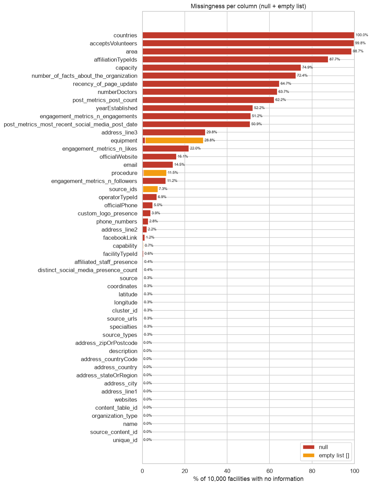

**How to read it:** red is a true null and orange is an empty list (the field exists but nothing was extracted). For evidence purposes both mean *no information*.

| Column | % no info | Comment |
|---|---|---|
| countries | 100.0 | Dead column |
| acceptsVolunteers | 99.8 | Dead column |
| area | 98.8 | Dead column; unit unknown |
| affiliationTypeIds | 87.7 | Mostly absent |
| **capacity (beds)** | **74.9** | Only 1 in 4 facilities has a bed count |
| number_of_facts_about_the_organization | 72.4 | |
| recency_of_page_update | 64.7 | |
| **numberDoctors** | **63.7** | |
| post_metrics_post_count | 62.2 | |
| **yearEstablished** | **52.2** | |
| engagement_metrics_n_engagements / last post date | ~51 | |
| address_line3 | 29.8 | |
| **equipment** | **28.8** (1.4 null + 27.4 empty/blank) | Most important gap |
| engagement_metrics_n_likes | 22.0 | |
| officialWebsite / email | 16.1 / 14.5 | |
| **procedure** | **11.5** (0.6 null + 10.9 empty) | |
| operatorTypeId | 6.9 | |
| capability / specialties | 0.6 / 0.3 | Almost always present |

**Compared with the challenge brief:**

| Field | Brief says | Non-null | Non-null **and** non-empty, blank-only lists counted as empty |
|---|---|---|---|
| description | 100 | 100 | 100 |
| capability | 99.7 | 99.6 | 99.3 |
| procedure | 92.5 | 99.4 | **88.5** |
| equipment | 77.0 | 98.6 | **71.2** |
| yearEstablished | 47.8 | 47.8 | 47.8 |
| numberDoctors | 36.4 | 36.3 | 36.3 |
| capacity | 25.2 | 25.1 | 25.1 |

**What it means:**
- The brief's figures treat `[]` as missing but miss lists that contain only `""`.
- Real coverage is worse: **equipment is usable for 71%** of facilities and procedure for 88.5%.
- Equipment (MRI scanner, dialysis machines, ventilators) is usually the strongest proof that a service exists, and it is missing for 29% of facilities.

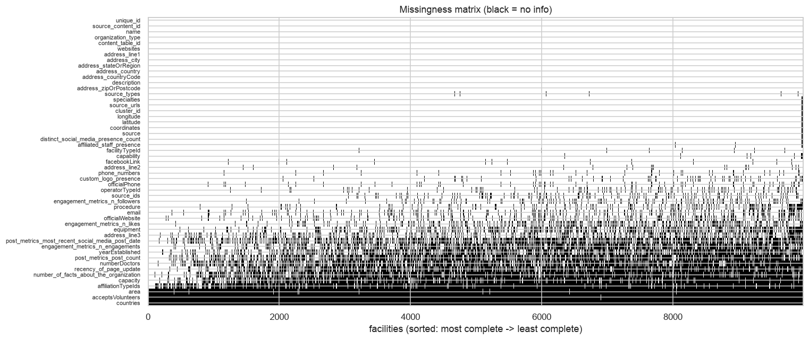

**How to read it:** each column of pixels is one facility, sorted from most to least complete; black means no info.
- The median facility is missing **11 of 51** fields (mean 10.4, min 1, max 30).
- The right-hand tail (up to 30 missing) is mostly the truncated records.

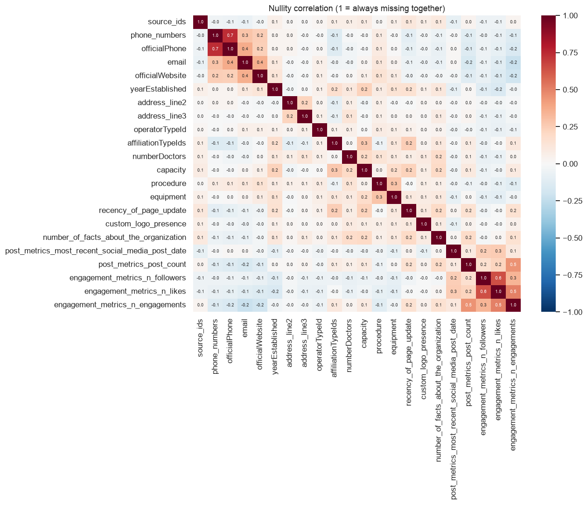

**What goes missing together** (1 = always missing together):

| Pair | r |
|---|---|
| phone_numbers ↔ officialPhone | 0.74 |
| n_followers ↔ n_likes | 0.65 |
| n_likes ↔ n_engagements | 0.51 |
| post_count ↔ n_engagements | 0.45 |
| officialPhone ↔ email | 0.37 |
| email ↔ officialWebsite | 0.37 |
| procedure ↔ equipment | 0.29 |

**What it means:** missingness clusters around **web presence**. Facilities with little online footprint lack contact details, social stats and evidence all at once. The data is **not missing at random**: small, offline and rural facilities are under-described.

**Missingness depends on facility type** (% missing):

| Type | n | year | doctors | capacity | equipment | procedure |
|---|---|---|---|---|---|---|
| hospital | 5,626 | 45.3 | 61.3 | 57.7 | 16.4 | 8.9 |
| clinic | 3,782 | 60.5 | 66.4 | **96.7** | 31.9 | 6.2 |
| dentist | 490 | 65.5 | 64.3 | **99.2** | 30.2 | 7.1 |
| public operator | 465 | 45.4 | 73.5 | 46.0 | 14.6 | 18.1 |

**What it means:**
- Bed counts exist almost only for hospitals.
- Filling in missing beds or doctors and showing the result as fact would be misleading.
- Treat "unknown" as its own state and show it.

---

## 5. Dead / constant / redundant columns

| Column | Problem |
|---|---|
| `organization_type` | Constant: always `facility` |
| `address_country`, `address_countryCode` | Constant: always `India` / `IN` |
| `source` | Constant: always `kie` |
| `countries` | 100% null |
| `acceptsVolunteers` | 21 non-null values (14 true, 7 false) |
| `area` | 125 non-null values, unknown unit (0 to 1,125,000) |
| `content_table_id` | Identical to `source_content_id` in 100% of rows |
| `coordinates` | Identical to `latitude` / `longitude` |

**What it means:** 10 of 51 columns carry no usable signal. Drop them from the model and the UI.

---

## 6. Categorical fields

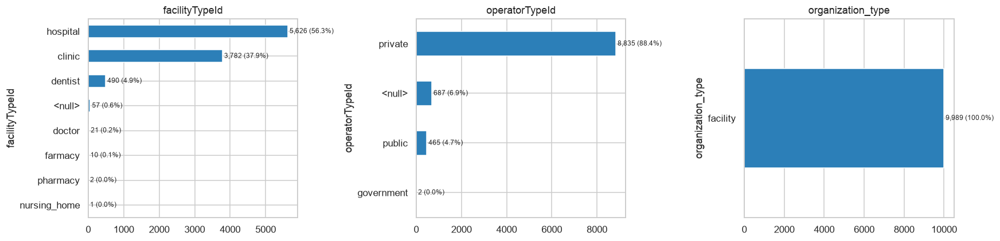

**facilityTypeId**

| Value | n | % |
|---|---|---|
| hospital | 5,626 | 56.3 |
| clinic | 3,782 | 37.9 |
| dentist | 490 | 4.9 |
| (null) | 57 | 0.6 |
| doctor | 21 | 0.2 |
| farmacy (typo) | 10 | 0.1 |
| pharmacy | 2 | <0.1 |
| nursing_home | 1 | <0.1 |

**operatorTypeId**

| Value | n | % |
|---|---|---|
| private | 8,835 | 88.4 |
| (null) | 687 | 6.9 |
| public | 465 | 4.7 |
| government | 2 | <0.1 |

**What it means:**
- `farmacy` and `pharmacy` are the same category, and so are `public` and `government`. Merge them.
- **The dataset is 88% private.** Government facilities (PHCs, CHCs, district hospitals) are badly under-represented, yet they matter most for rural and low-income patients, such as the community health worker in rural Bihar in the brief.
- Of 5,626 hospitals, only 438 are labelled public.

**affiliationTypeIds** (87.7% null). Lists repeat values, with one entry per merged source, so we count facilities rather than entries:

| Value | Facilities | Raw entries |
|---|---|---|
| government | 669 | 3,338 |
| academic | 470 | 1,818 |
| philanthropy-legacy | 206 | 329 |
| faith-tradition | 122 | 242 |
| community | 112 | 130 |
| others (NMC, NAAC, DCI, INC, RGUHS…) | 1 each | |

**source_types:** overture is in 9,155 facilities, dynamic 6,932, constant 3,386, mongo_facility 1,124 and mongo_ngo 228. The most common combinations are `dynamic+overture` (3,030), `overture` only (2,366) and `constant+dynamic+overture` (2,192).

**Booleans:**
- `affiliated_staff_presence`: 9,250 true, 696 false, 43 null.
- `custom_logo_presence`: 8,600 true, 998 false, 391 null.
- Both are nearly always true, so they carry little information.

**distinct_social_media_presence_count:** mostly 1 to 6. The value 5 is the most common (2,736), and 434 facilities have 0.

---

## 7. Evidence list fields

### 7a. List lengths and the 50-item cap

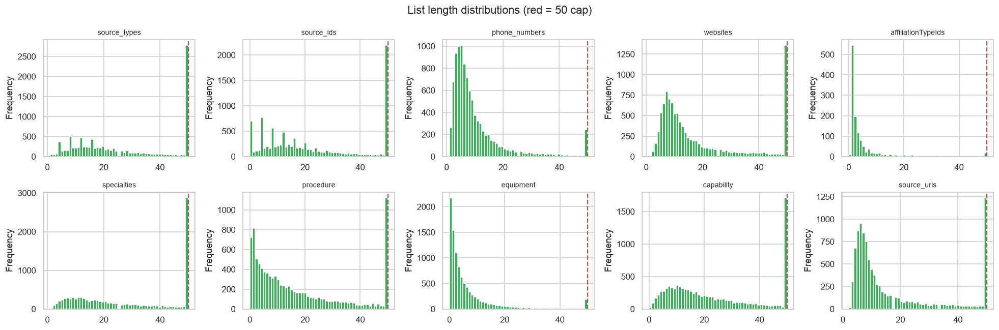

| List | Median length | Mean | % at cap of 50 | % empty | Mean duplicate share within list |
|---|---|---|---|---|---|
| source_types | 23 | 27.3 | 27.9 | 0 | 89.1% |
| source_ids | 17 | 22.7 | 22.0 | 7.0 | 78.1% |
| phone_numbers | 7 | 9.9 | 2.4 | 0 | 52.5% |
| websites | 12 | 18.7 | 13.6 | 0 | 12.8% |
| **specialties** | 24 | 28.0 | **28.8** | 0 | **55.1%** |
| **procedure** | 11 | 16.8 | 11.3 | 7.2 | 3.7% |
| **equipment** | 3 | 6.1 | 1.9 | 21.8 | 4.3% |
| **capability** | 19 | 23.3 | **17.2** | 0.2 | 2.6% |
| source_urls | 10 | 17.0 | 12.4 | 0 | 3.8% |

**What it means:**
- The red dashed line in each histogram is the **hard cap at 50**. The spike there shows the lists were **cut off during extraction**: whatever came after item 50 is gone.
- **32.2% of facilities have at least one evidence list at the cap.**
- Specialties repeat heavily within a list: more than half of all entries are repeats, because each merged source re-adds `internalMedicine`. Always use the set of unique values.

### 7b. Specialties vocabulary

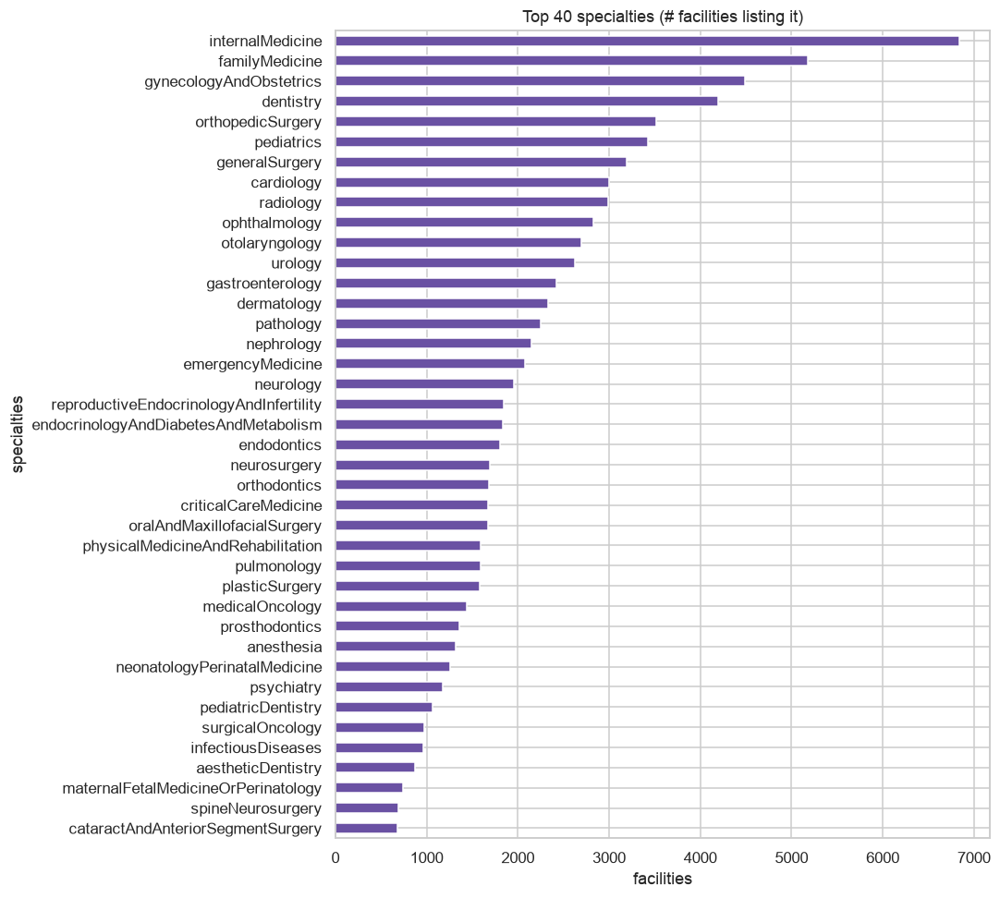

- There are **2,933 distinct specialty strings**. 2,072 look like the controlled camelCase vocabulary and 861 are free-form: `Cardiology`, `Orthopaedics`, `painMedicinePMR`, and even `""`.
- **1,976 specialty strings appear in only one facility**, a long tail of noise.
- **`internalMedicine` is listed by 68% of facilities**, which makes it close to a default value with almost no information.
- The top specialties (familyMedicine, dentistry, gynecologyAndObstetrics, ophthalmology, orthopedicSurgery, pediatrics, cardiology…) mirror the type mix: lots of clinics and dentists.

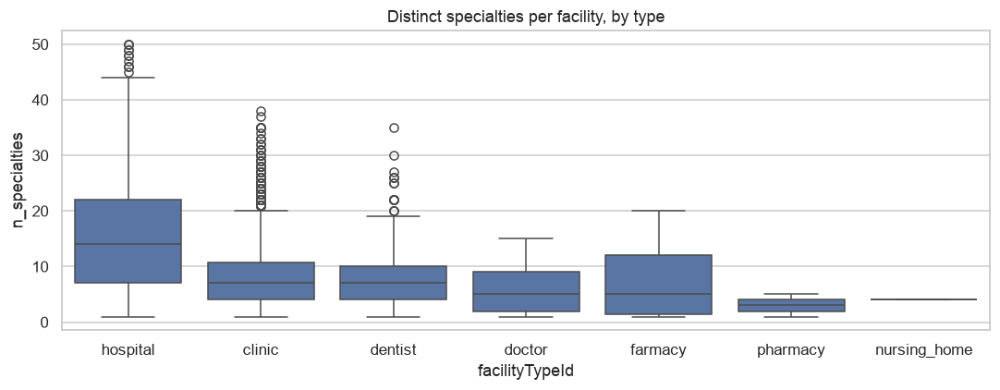

- Hospitals have a median of about 14 distinct specialties and clinics or dentists about 7.
- **Some clinics list 30 to 38 specialties and some dentists list 35.** That is implausible for a single-chair practice, and points to boilerplate or merged text.
- Hospitals at 45 to 50 are capped lists.

### 7c. Free-text evidence items

| Field | Items | Distinct (lower-cased) | Median item length |
|---|---|---|---|
| equipment | 60,070 | 33,887 | 29 chars |
| procedure | 167,272 | 82,717 | 27 chars |
| capability | 232,295 | 165,169 | 41 chars |

**Most common items** (number of facilities):
- **Equipment:**
  - Imaging: CT scanner (524), MRI scanner (322), X-ray imaging equipment (280), ultrasound machine (212), ECG machine (208).
  - Not medical: "wheelchair accessible entrance and exit" appears under three spellings (359 + 310 + 267).
- **Procedure:** dental implants (569), root canal (482), teeth whitening (401), laparoscopic surgery (338), cataract surgery (288).
- **Capability:** outpatient dental clinic (531), operates 24/7 (492), 24/7 emergency care (486), NABH accredited (461), "has 1 doctor on staff" (337).

**What it means:**
- Free text has huge spelling variation ("wheelchair-accessible" / "wheel chair accessible" / "wheelchair accessible"), so exact matching fails. Use regex with synonym lists, or embedding search.
- Some "equipment" is not medical at all (parking, wheelchair access, luxurious rooms).
- **NABH accredited** (461 + 268 spelling variants) is a useful quality signal you can cite.

### 7d. Extraction artefacts: blank items and LLM placeholders

| Field | Facilities with a blank `""` item | Blank items | LLM placeholder items | Facilities with a placeholder |
|---|---|---|---|---|
| specialties | 9 | 9 | 0 | 0 |
| procedure | 2,310 | 3,625 | 272 | 255 |
| equipment | 2,312 | 4,072 | 363 | 321 |
| capability | 713 | 830 | 30 | 25 |

Placeholder examples found **inside the equipment lists**:
- *"No equipment details provided for FMRI in the provided content."*
- *"No specific medical imaging devices or equipment listed for Fortis Hospital Anandpur, Kolkata in provided content."*
- *"No specific medical equipment listed for Civil Hospital in the provided content."*

**What it means:**
- These are LLM extraction outputs saying *nothing was found*. A naive "has equipment" check counts them as evidence, and a keyword search for "imaging" would match a sentence that actually says there is *no* imaging.
- **Filter them out before scoring.**

---

## 8. Location

### 8a. States

- There are **234 distinct raw state strings**, but India has 28 states and 8 UTs.
- Typos and aliases: `Tamilnadu` (22), `Orissa` (7), `Up` / `U.p.` / `U.p` (13), `Chattisgarh` (3), `Telengana`, `Pondicherry`, `Nct Of Delhi`, `Ts`, `Punjab Region`, `Jammu & Kashmir`.
- **284 rows (159 distinct values) have a city or district in the state field**: Thane 13, Mumbai 12, Navi Mumbai 12, Pune 10, Chennai 10, Hyderabad 9, Thiruvananthapuram 7…
- After normalising against the India Post names and **filling 272 rows from the PIN**, only **12** remain unknown.

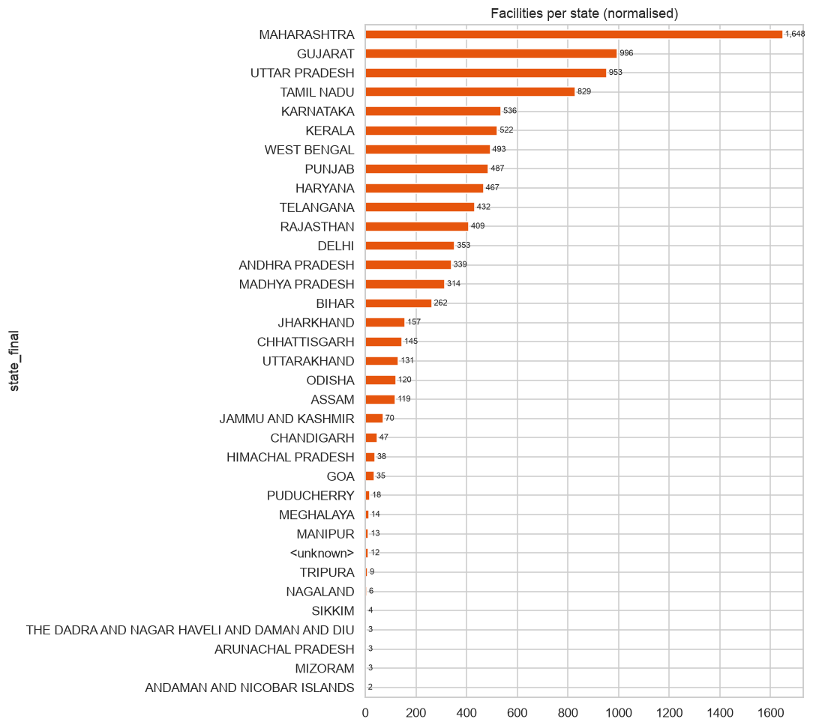

| State | Facilities |
|---|---|
| Maharashtra | 1,648 |
| Gujarat | 996 |
| Uttar Pradesh | 953 |
| Tamil Nadu | 829 |
| Karnataka | 536 |
| Kerala | 522 |
| … | |
| Arunachal Pradesh, Mizoram | 3 each |
| Andaman & Nicobar | 2 |
| **Ladakh, Lakshadweep** | **0** |

**What it means:**
- **The top 5 states hold 49.7% of all facilities.**
- Bihar has 262 facilities for about 130 million people, against 1,648 for Maharashtra.
- The North-East is nearly empty. The brief's "rural Bihar dialysis" scenario lands exactly where the data is thinnest.

### 8b. PIN codes

| PIN format | n |
|---|---|
| 6 digits | 9,762 |
| 6 digits with a space (`"201 301"`) | 153 |
| malformed (`"10"`, `"5600"`, `"641-602"`, `"124..."`) | 70 |
| missing | 4 |

- **97.8%** of valid-format PINs (9,700 / 9,915) exist in the India Post directory.
- PIN first digits (postal zones): 4 (west) 2,125, 1 (north) 1,448, 3 1,404, 6 1,355, 5 1,296, 2 1,083, 7 780, 8 417.
- **Address state vs PIN state conflicts: 65 of 9,428 (0.7%).**
  - 25 are *Andhra Pradesh ↔ Telangana*, left over from the 2014 state split (Hyderabad is listed as AP).
  - The rest are real conflicts, e.g. *Aravind Eye Hospital, Hyderabad, Telangana* with PIN 110002 (Central Delhi), or *District Hospital Durg, Chhattisgarh* with PIN 262701 (Kheri, UP).

**What it means:** the PIN is the most reliable location key in the record. Use it to infer and check state and district.

### 8c. Cities

- There are **1,628 distinct city strings**: Mumbai 364, Hyderabad 358, Chennai 326, Ahmedabad 325, Pune 274, Kolkata 243…
- Old and new names coexist:

| City | Variant counts |
|---|---|
| Bengaluru | Bangalore 204 / Bengaluru 109 |
| Gurugram | Gurgaon 82 / Gurugram 65 |
| Thiruvananthapuram | 52 / Trivandrum 20 |
| Vadodara | 128 / Baroda 4 |
| Mysuru | Mysore 10 / Mysuru 11 |
| Puducherry | 5 / Pondicherry 9 |

- Some city values are localities: "Kandivali West", "Kondapur", "Mandaveli".

**What it means:** never match user location input by city string. Geocode through the PIN directory, or use an alias table.

### 8d. Coordinates

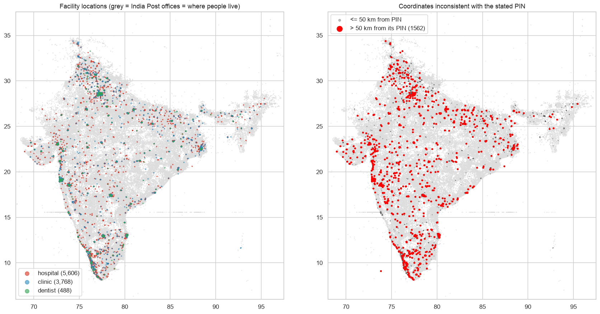

**Left map:** facilities by type over a grey silhouette of 150k India Post offices, which roughly shows where people live.
- Facilities cluster in metros (Delhi NCR, Mumbai/Pune, Bengaluru, Chennai, Hyderabad, Kolkata, Ahmedabad) and along the Kerala coast.
- Large areas of central India (Chhattisgarh, MP, Odisha, Jharkhand) and the North-East are nearly empty, even though people live there.

**Right map:** red marks facilities whose coordinates are **more than 50 km from the centroid of their own PIN code**.

| Check | n |
|---|---|
| Have coordinates | 9,959 |
| Outside India entirely | **6** (e.g. Nagpur clinic at lat 2.95, lon 41.4, near Somalia; Lucknow hospital at lat −81.7, Antarctica) |
| Lat/lon swapped or (0,0) | 0 |
| Distance to PIN centroid: median | 2.4 km |
| > 10 km | 2,617 (27.1%) |
| > 25 km | 1,965 (20.3%) |
| **> 50 km** | **1,562 (15.6%)** |
| > 100 km | 1,227 (12.7%) |
| > 500 km | 195 (2.0%) |

- Is this noise in the PIN directory? **No.** Offices sit a median of 2.4 km from their PIN centroid (90th percentile 12.7 km), so the centroids are reliable.
- A facility 100+ km from its PIN therefore has a **real contradiction** between its address and its coordinates.
- Exact duplicate coordinates: 37 points are shared by 79 facilities. Example: 4 Warangal and Hanamkonda facilities sit at the identical point (17.9982, 79.5533), a geocode to a locality centroid rather than the building.
- Precision: most coordinates have 14 or 15 decimals, which is float noise rather than real precision.

**What it means:**
- If the recommender ranks by straight-line distance from raw lat/long, about **1 in 6 answers could point to the wrong city**.
- Check every facility's coordinates against its PIN and city.
- When they disagree, fall back to the PIN centroid and **mark the location confidence as low**.

---

## 9. Numeric fields

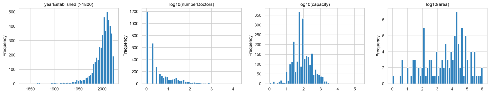

| Field | n | Median | p95 | p99 | Max |
|---|---|---|---|---|---|
| yearEstablished | 4,775 | 2005 | 2021 | 2023 | 2025 (min **0**) |
| numberDoctors | 3,628 | **2** | 94 | 409 | **15,000** |
| capacity (beds) | 2,510 | 100 | 798 | 1,671 | **200,000** |
| area | 125 | 5,550 | 318,000 | 1,049,249 | 1,125,000 (unit unknown) |

**How to read the charts:**
- **yearEstablished:** most facilities were founded 1990–2020, peaking around 2010. The dataset is young and private-sector heavy.
- **numberDoctors** (log scale): a huge spike at 1 doctor (1,194 records), then 2 (673), 3 (283).
- **capacity** (log scale): spikes at 50 and 100 beds, the round numbers.
- **area:** sparse and spread across 6 orders of magnitude, so it is unusable.

**Implausible or suspicious values**

| Check | Rows |
|---|---|
| yearEstablished = 0 | 3 |
| yearEstablished 1–1799 (e.g. **7**, **15**, 1723, 1756) | 4 |
| numberDoctors = 0 | 13 |
| numberDoctors > 1,000 | 11 (Nithya Hospital, Dharmapuri: **15,000**; KIMS: 6,000; Scientific Pathology, Agra: 5,000) |
| capacity = 0 | 13 |
| capacity > 3,000 | 2 (**Harsh Hospital, Motihari: 200,000 beds**) |
| clinic with > 200 beds | 10 |
| **1 doctor but ≥ 100 beds** | **72** (KGMU Lucknow: 4,000 beds / 1 doctor; KIMS: 3,000 / 1) |

**Value heaping**
- **71%** of bed counts (≥10) are multiples of 10 and 47% are multiples of 50. Exact counts would give about 10% and 2%.
- 34% of doctor counts (≥10) are multiples of 10.
- The most common bed counts are 100 (300), 50 (261), 30, 150, 200 and 300.

**What it means:**
- Bed counts are **rough estimates**: use them only as a coarse size band (small / medium / large).
- `numberDoctors = 1` most likely means *one named doctor was found on a page*, not that the hospital has one doctor.
- Never rank on raw doctor or bed counts without capping them and flagging outliers.

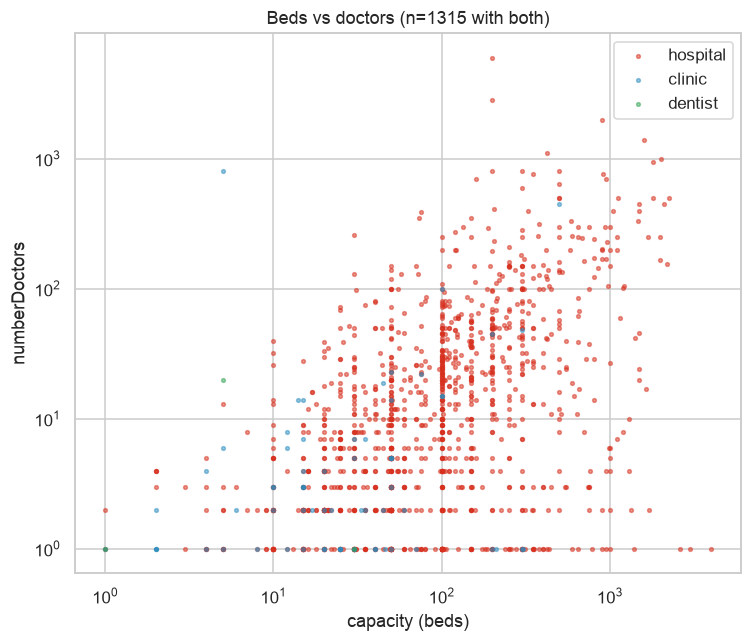

- Only 1,315 facilities have both values above zero.
- Beds per doctor has a median of 7.1, but the scatter is enormous (a horizontal band at 1 doctor across all bed sizes). The two fields are only loosely related (ρ = 0.47).

Median by type: hospitals have 5 doctors, 100 beds and were founded in 2003; clinics have 1 doctor, 25 beds (only 124 report) and were founded in 2009.

---

## 10. Correlations

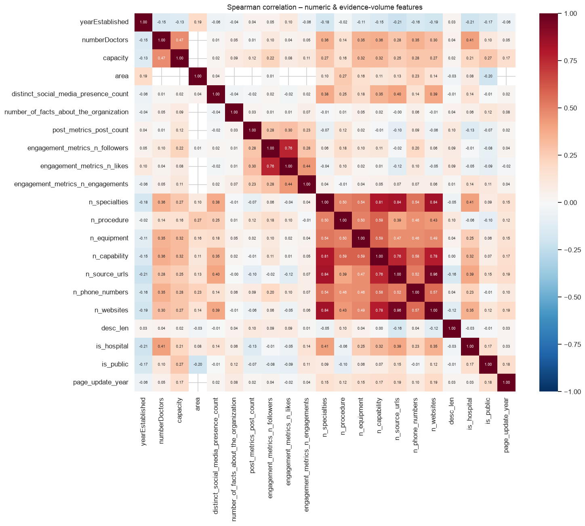

Spearman rank correlation is used because every variable is heavily skewed.

| Strongest positive | ρ |
|---|---|
| n_source_urls ↔ n_websites | 0.96 |
| n_specialties ↔ n_websites | 0.84 |
| n_specialties ↔ n_source_urls | 0.84 |
| n_specialties ↔ n_capability | 0.81 |
| n_capability ↔ n_websites | 0.78 |
| followers ↔ likes | 0.76 |
| n_equipment ↔ n_capability | 0.59 |
| numberDoctors ↔ capacity | 0.47 |
| is_hospital ↔ numberDoctors | 0.41 |

| Strongest negative | ρ |
|---|---|
| yearEstablished ↔ n_source_urls | −0.21 |
| yearEstablished ↔ is_hospital | −0.21 |
| area ↔ is_public | −0.20 |

**What it means:**
- **How much a facility appears to offer is driven by how much of the web was scraped about it.** More URLs mean more specialties and more capabilities (ρ ≈ 0.8).
- A ranker that rewards "number of evidence items" mostly rewards **online visibility (SEO)**, not clinical capability. Normalise or cap evidence counts, and reward *independent field agreement* rather than volume.
- Older facilities have more sources and are more likely to be hospitals: established institutions are better documented.
- Social engagement barely correlates with size or capability (ρ ≤ 0.2). It is a **popularity signal, not a quality signal**.

---

## 11. Dates, social media, engagement

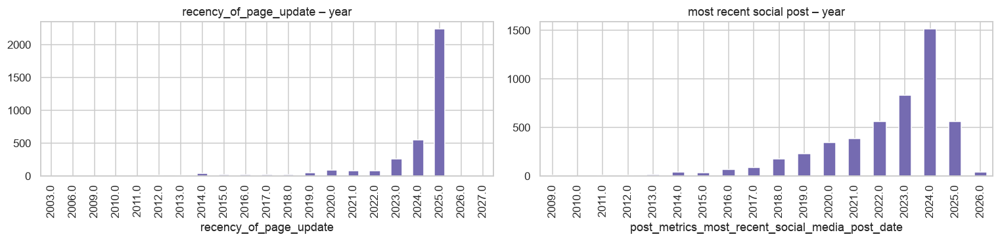

| Field | n | Min | Median | Max |
|---|---|---|---|---|
| recency_of_page_update | 3,526 | 2003‑09‑04 | 2025‑05‑18 | **2027‑07‑20** (1 date in the future) |
| last social post | 4,907 | 2009‑06‑29 | 2023‑07‑25 | 2026‑01‑22 |

- Page updates spike in 2025, so most source pages are recent.
- **2,793 facilities last posted on social media before 2024.** They may be inactive or closed. That is a useful staleness warning.

| Engagement | n | Median | p99 | Max |
|---|---|---|---|---|
| followers | 8,873 | 245 | 35,533 | **15,000,000** |
| likes | 7,789 | 69 | 18,000 | 384,000 |
| engagements | 4,877 | 0 | 2,778 | 121,855 |
| post count | 3,774 | 0 | 275 | 59,000 |

- 1,190 facilities have zero followers and 2,511 have zero posts.
- **J J Eye Hospital, Mumbai** and **Shiromany Dental Care, Agra** both have exactly 15,000,000 followers.
- **Kidwai Memorial (Bengaluru)**, **Fortis (Bangalore)** and **Shankar Super Speciality** all have exactly 4,756,342 followers.

**What it means:** follower counts often belong to the wrong page, such as a brand page or a shared aggregator page. **Do not use engagement for ranking.** At most, it can be a weak sign that a facility is still active.

---

## 12. Contact info & provenance

**Phones**
- 96,573 entries, 37,162 distinct, mostly `+91XXXXXXXXXX`.
- The median facility has 3 distinct phones; the maximum is 48.
- `officialPhone` appears in `phone_numbers` 99.7% of the time.
- **104 official numbers are shared by more than one facility**: chain call centres or merged records.

**Emails**
- 62% use free-mail providers (gmail 4,730, yahoo 284…).
- **363 are `[email protected]`**: Cloudflare's anti-scraping placeholder, captured verbatim. They are invalid.

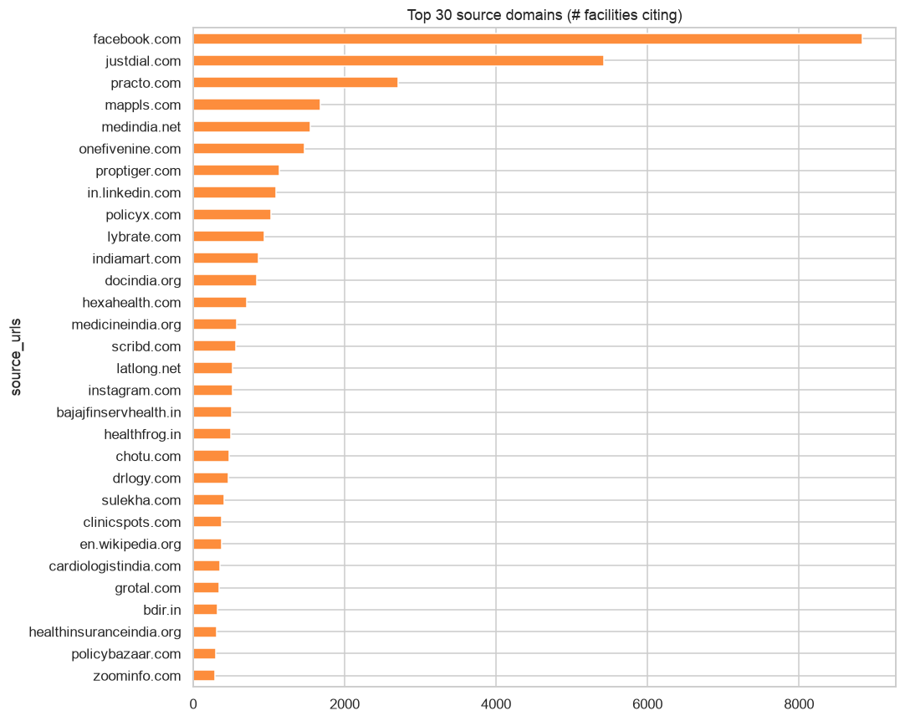

**Source URLs**
- 158,444 URLs across **12,144 distinct domains**.
- Median per facility: 10 URLs from 6 distinct domains.
- Top domains (facilities citing them): **facebook.com (~8,800)**, **justdial.com (~5,400)**, **practo.com (~2,700)**, mappls.com, medindia.net, onefivenine.com, proptiger.com, linkedin, policyx, lybrate, indiamart, docindia…
- **Only 47% of records (4,735) include the facility's own website among their sources.**
- **1,013 records have at least one `.gov.in` / `nic.in` source**, e.g. state empanelment lists and government hospital directories.

**What it means:**
- Most evidence comes from **aggregators and directories**. These are often outdated and are the main source of merged information: a justdial or practo listing page mentions many facilities, and the extractor mixes them up.
- Weight evidence by **source quality**: government site and own website > accredited directory > aggregator or social.
- Always show the source URL next to the claim so users can check it themselves.

---

## 13. Description text

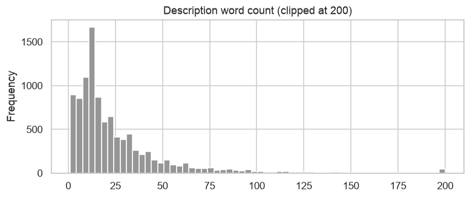

- Length: median 115 characters, 5th percentile 21, 95th percentile 535, max 6,557.
- **1,206 descriptions are under 40 characters.** 158 are just the facility name.
- 569 descriptions are shared word-for-word by more than one facility: "Hospital" (40), "Open 24 Hrs" (34), "Dental Clinic" (30), "Providing exceptional cardiac care to the community" (22).
- 42 contain non-Latin script, such as Hindi.

**What it means:** the description is always present but often empty of content. It is a weak evidence field; prefer procedure, equipment and capability.

---

## 14. Duplicates, merged & contradictory records

### Duplicates
- Exact duplicate rows: 11 (removed).
- Same name in any city: 831 rows. This is mostly chains and generic names: Apollo Clinic 10, City Hospital 8, Fortis Hospital 5, ESI Hospital 5…
- **Same name and same city: 12 rows.** Some are near-duplicates (*Rajindra Hospital Patiala* vs *Rajindra Hospital, Patiala*, same PIN). Some are suspicious: *Sarla Hospital, Mumbai*, same PIN, but one set of coordinates is 300 km away in Vidarbha.
- `cluster_id` has 0 duplicates after cleaning, so it is a usable entity key.

### Merged-record showcase: the very first row
> **Aravind Eye Hospital**. City: *Hyderabad*, state: *Telangana*, PIN: *110002 (Central Delhi)*. Coordinates point to *Pondicherry*, **1,871 km** from its PIN. 650 beds but 1 doctor, 33 distinct phone numbers. Its capability list mentions *Madras Medical Mission, Chennai*, *Janakpuri Super Speciality Hospital*, *Delhi Government Hospitals*. Its procedure and equipment include a 20-bed dialysis unit and a 1,241-bed oxygen pipeline (which belongs to a Delhi government hospital).

That is at least four different facilities merged into one record. A naive system would recommend *Aravind Eye Hospital* for **dialysis in Delhi**.

A second example is a Fortis record whose equipment list mixes Fortis Gurgaon (CyberKnife, 15 OTs), Fortis Anandapur Kolkata, Fortis Mulund, S L Raheja and **Nair Hospital, Mumbai Central**.

### Red flags per facility

| Flag | n | % |
|---|---|---|
| Any evidence list at the 50 cap | 3,220 | 32.2 |
| No equipment evidence | 2,878 | 28.8 |
| Coordinates > 50 km from PIN | 1,562 | 15.6 |
| Clinic, dentist or doctor claiming heavy services (ICU, dialysis, cardiac surgery, NICU, C‑section…) | 567 | 5.7 |
| PIN missing or invalid | 289 | 2.9 |
| > 20 distinct phone numbers | 122 | 1.2 |
| Implausible numbers | 121 | 1.2 |
| State ≠ PIN state | 65 | 0.7 |
| Truncated record | 30 | 0.3 |
| Coordinates outside India | 6 | 0.1 |

Red flags per facility, excluding the "no equipment" flag:

| # flags | 0 | 1 | 2 | 3 | 4 | 5 |
|---|---|---|---|---|---|---|
| Facilities | 5,369 | 3,441 | 1,016 | 146 | 14 | 3 |

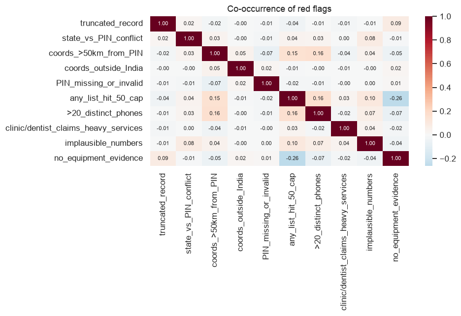

**Lists at the cap are a signal of merged records:**

| | State ≠ PIN | Coordinates > 50 km from PIN | > 20 phones |
|---|---|---|---|
| Lists below cap | 0.4% | 11.8% | 0.0% |
| **Some list at 50 cap** | **1.1%** | **23.8%** | **3.7%** |

**What it means:**
- Records with capped lists are **twice as likely** to have conflicting locations and are the only ones with large phone lists. Both are typical of several facilities merged into one.
- "Lots of evidence" is therefore **not automatically good**: past a point it suggests a merge.
- About **46% of facilities have at least one red flag.** That is enough to justify showing a confidence label on every result.

---

## 15. Service-claim coverage

For each challenge service we searched all five evidence fields (specialties, procedure, equipment, capability, description) with a keyword pattern. **Evidence depth** is the number of independent fields that mention the service.

| Service | Specialties | Procedure | Equipment | Capability | Description | **Any field** | Only 1 field | 3+ fields | **% weak** |
|---|---|---|---|---|---|---|---|---|---|
| obstetrics / delivery | 4,528 | 1,212 | 459 | 2,552 | 465 | **4,935** | 2,233 | 1,242 | 45 |
| trauma / emergency | 2,492 | 1,408 | 290 | 3,492 | 544 | **4,232** | 1,556 | 1,064 | 37 |
| ICU | 1,860 | 243 | 910 | 2,117 | 299 | **2,925** | 1,226 | 663 | 42 |
| oncology | 2,224 | 1,345 | 181 | 1,519 | 324 | **2,846** | 1,208 | 804 | 42 |
| dialysis | 2,200 | 796 | 475 | 1,322 | 212 | **2,483** | 1,027 | 729 | 41 |
| NICU | 1,290 | 130 | 243 | 899 | 119 | **1,562** | 769 | 269 | 49 |
| CT scan | 0 | 803 | 1,398 | 520 | 115 | **1,532** | 643 | 363 | 42 |
| cardiac surgery | 760 | 443 | 28 | 347 | 29 | **983** | 559 | 182 | **57** |
| MRI | 0 | 453 | 885 | 334 | 68 | **950** | 412 | 221 | 43 |
| cath lab | 2 | 615 | 526 | 281 | 41 | **847** | 389 | 148 | 46 |
| blood bank | 0 | 59 | 330 | 361 | 42 | **558** | 355 | 29 | **64** |
| **C‑section** | 0 | 433 | 5 | 96 | 14 | **449** | 354 | **4** | **79** |
| ventilator | 0 | 39 | 400 | 104 | 32 | **441** | 322 | 15 | **73** |
| burn care | 134 | 115 | 29 | 156 | 23 | **280** | 156 | 47 | 56 |

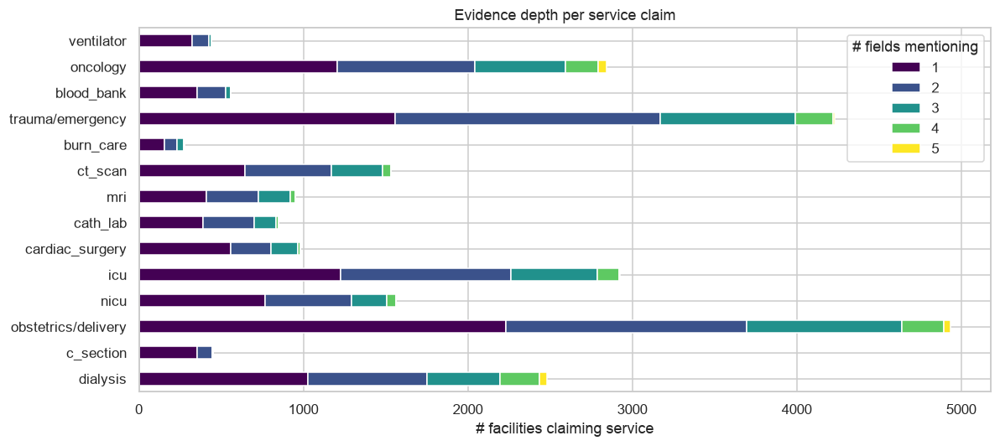

**What it means:**
- **Emergency C‑section, a headline service in the brief, is the weakest.** Only 449 facilities mention it, 79% in just one field, and only **4** in three or more fields. Most hospitals that can do C‑sections never say so explicitly; they say "obstetrics", "labour room" or "operation theatre". The recommender has to **infer** C‑section capability (obstetrics + OT + anaesthesia + blood bank) and *label it as inferred*.
- **MRI and CT** never appear in specialties. They live in equipment, which is the best kind of evidence when present.
- **Burn care** is rare (280 facilities) and thin. Many queries will return "no strongly evidenced facility nearby", and the UI must handle that honestly.
- Dialysis, ICU and emergency are relatively well covered, with 600–1,000 facilities having evidence in 3 or more fields.

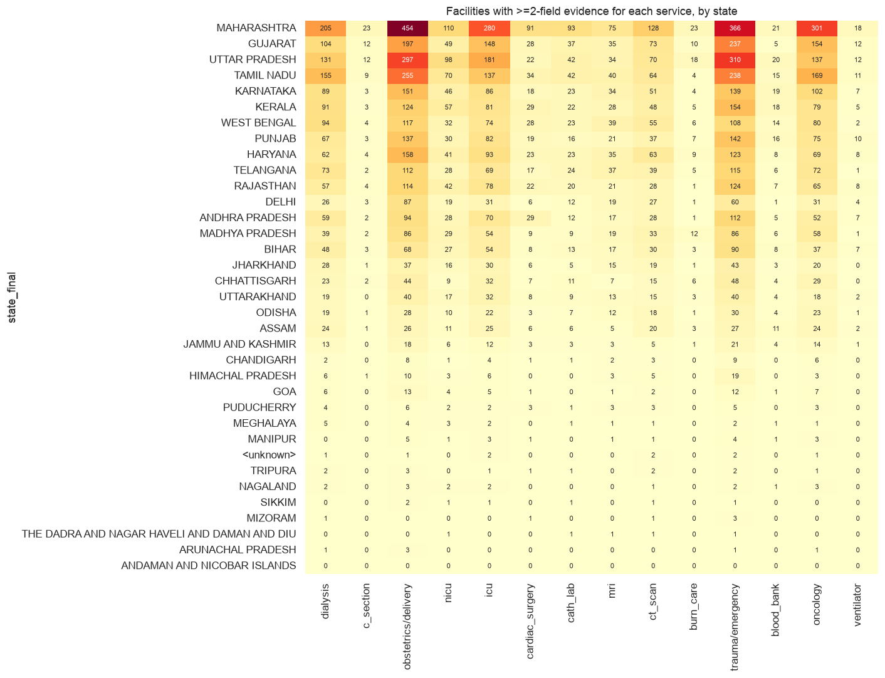

**How to read it:** the number of facilities with evidence in 2 or more fields, by service and state.
- **Maharashtra** leads everything: 205 dialysis, 454 obstetrics, 280 ICU, 366 emergency, 301 oncology.
- **Bihar** has 48 dialysis, 3 C‑section, 27 NICU and 3 burn care facilities with that level of evidence.
- **Most North-Eastern states have 0–5 for every service.** Andaman & Nicobar has 0 across the board.
- C‑section has 23 in Maharashtra and 0–4 in nearly every other state.

**Claims by facility type** (% with evidence in 2 or more fields): hospitals claim dialysis at 24%, ICU 28.8%, obstetrics 40.6% and emergency 41.3%.
- **Clinics** still show dialysis at 2.7%, ICU 2.0% and obstetrics 10.8%.
- **Dentists** show emergency at 10.6% and oncology at 3.3%. These are almost certainly merged or boilerplate text, such as "dental emergency" or "oral cancer screening".

**Specialty tag vs free text (dialysis):**

| | Dialysis in procedure/equipment/capability | Not mentioned |
|---|---|---|
| `nephrology` in specialties | 1,327 | **826** |
| No nephrology | **293** | 7,543 |

**What it means:**
- 826 facilities list nephrology but say nothing about dialysis.
- 293 describe dialysis without the specialty tag.
- Specialty tags and free text disagree about 1 time in 9. **Use both, and weight concrete equipment or procedure sentences above tags.**

---

## 16. India Post PIN directory

| Fact | Value |
|---|---|
| Rows (post offices) | 165,627 |
| Distinct PINs / districts / states / postal circles | 19,586 / 749 / 36 / 24 |
| Office types | BO (branch) 140,270, PO 24,546, HO (head) 811 |
| Delivery / non-delivery | 157,901 / 7,726 |
| Missing lat / lon (literal `"NA"`) | 12,013 / 12,008 (7.3%) |
| **Coordinates present but garbage or outside India** | **2,613**: e.g. `(79.0, 17.0)` swapped, `(35.9, 61.3)`, `(18.17, 18.17)` |
| Missing district / state | 715 each |
| PINs spanning > 1 state | 52 |
| PINs spanning > 1 district | 1,258 |
| Offices per PIN | median 7, max 153 |
| Office distance to its PIN's median centroid | median 4.4 km; **per-PIN median 2.4 km** (p90 12.7 km) |

**What it means:**
- After filtering to India's bounding box and taking the **median** office location per PIN, you get a reliable PIN-to-coordinates lookup and PIN-to-district and state tables.
- This is the backbone for turning a user's location input ("Jaipur", "PIN 302001") into coordinates, and for checking facility addresses.
- About 6% of PINs straddle districts, so district assignment by PIN is approximate.

---

## 17. NFHS‑5 district indicators

| Fact | Value |
|---|---|
| Rows / indicators | 706 districts × 107 indicators |
| Distinct district names | 698 (some names repeat across states: **Aurangabad** in Bihar and Maharashtra, **Bilaspur** in Chhattisgarh and HP, **Bijapur**, **Raigarh**, **Hamirpur**…) |
| `*` = suppressed (fewer than 25 cases) | **4,125 cells** |
| `(x)` = low reliability (25–49 cases) | **5,068 cells** |
| Real NaN | 0 (missingness is hidden in the `*` markers) |
| State name differences vs India Post | `Maharastra` (typo), `NCT of Delhi`, `Jammu & Kashmir`, `Andaman & Nicobar Islands`, `Dadra and Nagar Haveli & Daman and Diu` |

**Most suppressed indicators:**

| Indicator | % suppressed | % low reliability |
|---|---|---|
| children's adequate diet | ~91 | ~8 |
| diarrhoea treatment indicators | ~70 | ~23 |
| children born at home taken to a facility | 60 | 20 |
| **private-facility C‑section rate** | **21** | **17** |
| anaemia in pregnant women | 19 | 60 |

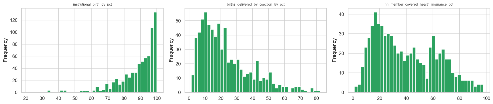

| Key indicator | Mean | Min | Median | Max |
|---|---|---|---|---|
| Institutional births % | 88.7 | 21.4 | 92.2 | 100 |
| **C‑section births %** | 22.8 | 1.4 | 18.6 | **82.4** |
| Private-facility C‑section % | 49.4 | 6.3 | 46.1 | 94.2 |
| Public-facility C‑section % | 17.3 | 0.7 | 13.0 | 73.0 |
| Household health insurance % | 40.2 | 1.2 | 35.7 | 97.8 |
| Out-of-pocket cost per public delivery (₹) | 3,529 | 193 | 2,830 | 20,101 |
| ≥ 4 antenatal visits % | 60.5 | 4.4 | 62.4 | 98.7 |

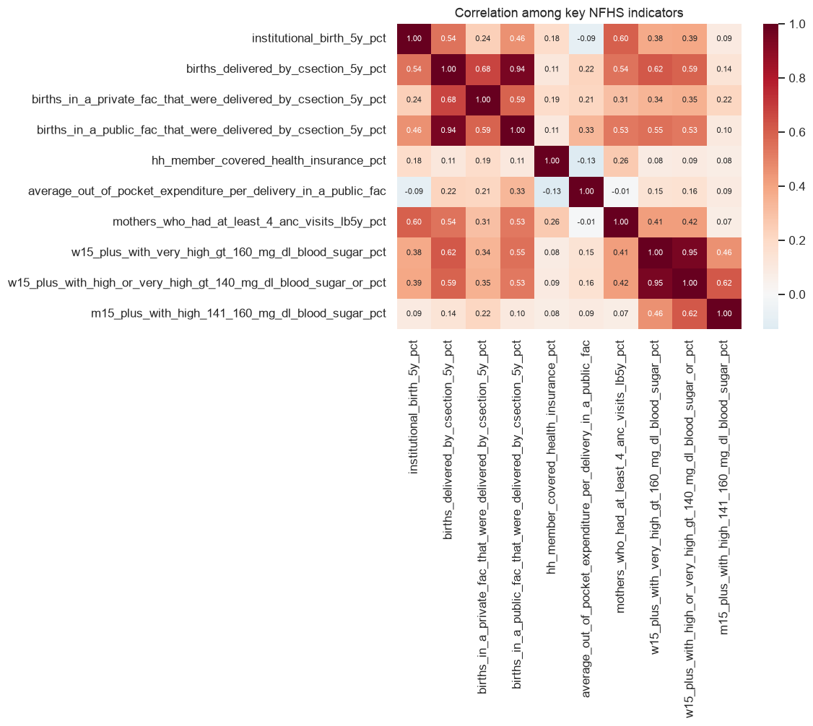

**What it means:**
- NFHS describes **need and context, not facilities**.
- Parse `*` as missing and `(x)` as "value with a low-reliability flag"; never drop the parentheses silently.
- Private facilities deliver by C‑section about 3 times as often as public ones (49% vs 17%).
- Join on **state + district**, never district alone.

---

## 18. Cross-dataset joins & coverage gaps

| Join | Result |
|---|---|
| Facilities mapped to a district via PIN | 9,700 |
| Distinct districts with ≥ 1 facility | 553 |
| **India Post districts with 0 facilities** | **201 of 754** |
| NFHS districts matched to India Post by name | 611 of 706 (the rest are renamed or new districts, or spelt differently: *Purba Champaran*, *Kamrup Metropolitan*, *Kabeerdham*, *Sri Potti Sriramulu Nellore*…) |

**NFHS districts by number of facilities in the dataset:**

| Facilities | 0 | 1–2 | 3–5 | 6–20 | 21–100 | > 100 |
|---|---|---|---|---|---|---|
| Districts | **246** | 155 | 91 | 123 | 74 | 17 |

- **35% of NFHS districts have no facility at all in the dataset, and 57% have 2 or fewer.**
- Top districts: Pune 328, Ahmedabad 324, Bengaluru Urban 294, Chennai 285, Mumbai Suburban 274, Thane 224, Hyderabad 222.

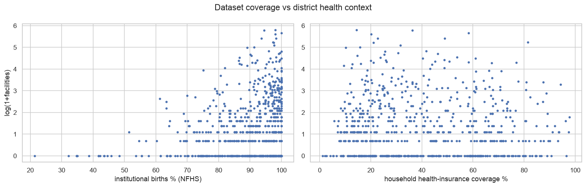

Spearman correlation of facility count with district indicators:

| Indicator | ρ |
|---|---|
| very high blood sugar (women) | 0.33 |
| C‑section births % | 0.31 |
| institutional births % | 0.29 |
| ≥ 4 ANC visits | 0.17 |
| health insurance | −0.03 |
| out-of-pocket cost per delivery | −0.08 |

**What it means:**
- The dataset is **denser where health infrastructure already exists** (urban, high institutional-birth districts) and thinnest where need is highest.
- **Districts with the highest NFHS C‑section rates but no facility with C‑section evidence in 2 or more fields** are all in Telangana: Karimnagar 82.4% (14 facilities, none evidenced), Jangoan 79.1% (0 facilities), Nirmal 77.3%, Rajanna Sircilla 77.2%, Suryapet 77.0%, Mahabubabad 74.0%, Warangal Rural 71.8%, Peddapalli 71.6%.
- People there clearly get C‑sections, but the dataset can't show where. **The gap is in the data, not in the care.**

**Facilities per NFHS district, by state:**

| Lowest | Facilities per district | Highest | Facilities per district |
|---|---|---|---|
| Ladakh, Lakshadweep, DNH‑DD | 0 | Chandigarh | 47 |
| Arunachal Pradesh | 0.2 | Maharashtra | 45.8 |
| Mizoram | 0.4 | Kerala | 37.3 |
| Nagaland | 0.5 | Delhi | 32.1 |
| Andaman & Nicobar | 0.7 | Gujarat | 30.2 |
| Bihar | 6.9 | | |

---

## 19. Per-facility completeness score

The score is the share of 12 evidence-bearing attributes that are present. It is a transparent profiling aid, not a ranking model.

| Attribute | % facilities |
|---|---|
| has specialties | 99.7 |
| has capability | 99.3 |
| valid PIN | 97.1 |
| has phone | 95.0 |
| has procedure | 88.5 |
| has official website | 83.9 |
| coordinates within 25 km of PIN | 77.2 |
| **has equipment** | **71.2** |
| description > 100 characters | 56.2 |
| has year | 47.7 |
| has doctors | 36.2 |
| **has capacity** | **25.0** |

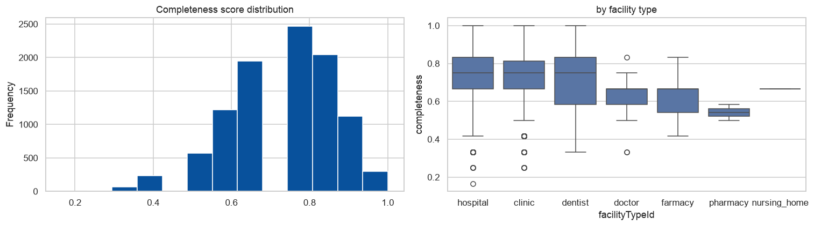

- Most facilities score between 0.6 and 0.85. Hospitals score higher than clinics and dentists.
- By state, the lowest averages are Himachal Pradesh 0.69, J&K 0.70, Assam 0.71, Gujarat 0.72 and UP 0.72; the highest are Goa 0.76, Delhi, Kerala and Telangana at 0.75.
- The differences between states are small. The bigger differences are **between facility types and between records with and without web presence**.

---

## 20. Exhaustive issue list

### Parsing / structure
1. Backslash-escaped quotes break standard CSV readers.
2. 88 junk rows from unquoted newlines in `description`.
3. 11 exact duplicate rows, so `unique_id` is not unique as shipped.
4. 30 truncated records with all post-description fields lost.
5. Three different encodings of missing: `null`, `""`, and `[]` / `[""]`.
6. Every column is text; 10 are JSON lists and 1 is GeoJSON.

### Columns
7. 10 constant, empty or redundant columns: `organization_type`, `address_country`, `address_countryCode`, `source`, `countries`, `acceptsVolunteers`, `area`, `content_table_id`, `coordinates`, plus near-constant booleans.
8. Category typos and overlaps: `farmacy` vs `pharmacy`, `government` vs `public`.
9. The dataset is 88% private; public and government facilities are under-represented (467).

### Evidence lists
10. A hard cap at 50 items truncates 32% of facilities' lists.
11. Heavy repetition inside lists (specialties 55%, source_types 89%).
12. 2,933 specialty strings: 861 free-form, 1,976 singletons.
13. `internalMedicine` appears on 68% of facilities, so it carries almost no information.
14. Blank `""` items in about 2,300 procedure and equipment lists.
15. LLM "no equipment listed…" placeholders inside evidence (363 equipment, 272 procedure items).
16. Non-medical items listed as equipment (wheelchair access, parking, rooms).
17. Huge spelling variation in free text (34k distinct equipment strings).
18. Specialty tags vs free text disagree (826 nephrology without dialysis; 293 dialysis without nephrology).
19. Clinics and dentists claiming heavy services (567).

### Location
20. 234 state spellings; 284 rows with a city in the state field.
21. 65 state–PIN conflicts (25 AP/Telangana).
22. 70 malformed and 153 space-separated PINs.
23. 1,562 facilities (15.6%) more than 50 km from their own PIN; 195 more than 500 km.
24. 6 coordinates outside India.
25. 37 shared coordinate points (locality-level geocodes).
26. City name variants (Bangalore/Bengaluru, Gurgaon/Gurugram…) and localities used as cities.
27. Coverage bias: the top 5 states hold 50%; 201 districts and 3 UTs have zero facilities.

### Numbers
28. Sparse scale fields (beds 25%, doctors 36%, year 48%), missing not at random.
29. Impossible values: 200,000 beds, 15,000 doctors, establishment years 0, 7 and 15.
30. 72 facilities with "1 doctor but ≥ 100 beds"; `numberDoctors = 1` is the most common value.
31. Value heaping: 71% of bed counts are multiples of 10.
32. Evidence volume tracks web footprint (ρ ≈ 0.8 with URL count), an SEO bias.

### Web / provenance
33. Follower counts copied across unrelated facilities (15M, 4.76M).
34. 2,793 facilities with no social post since before 2024 (possibly inactive).
35. One page-update date in the future (2027).
36. 363 Cloudflare-obfuscated emails.
37. 104 official phone numbers shared across facilities.
38. Most sources are aggregators (facebook, justdial, practo); only 47% include the facility's own site.
39. 1,206 descriptions under 40 characters; 569 boilerplate descriptions.

### Trust / merges
40. Records clearly merged from several facilities (Aravind / Delhi / Pondicherry; Fortis multi-city).
41. Capped lists double the rate of coordinate conflicts (23.8% vs 11.8%).
42. About 46% of facilities carry at least one red flag.

### Services
43. C‑section: 449 claims, 79% from one field, only 4 with three or more.
44. Ventilator 73% weak, blood bank 64%, cardiac surgery 57%, burn care 56%.
45. MRI and CT appear only in free text and equipment, never in specialties.
46. Service evidence is concentrated in Maharashtra, Gujarat, UP and Tamil Nadu; the North-East has near-zero coverage.

### Helper datasets
47. PIN directory: 7% missing coordinates and 2,613 garbage coordinates; 52 PINs span states and 1,258 span districts.
48. NFHS: 4,125 `*` and 5,068 `(x)` cells; state typos; duplicate district names across states; 95 districts don't match India Post by name.

---

## 21. Implications for the recommender

1. **Clean pipeline first.**
   - Use an escape-aware parse.
   - Drop the fragment rows and duplicates.
   - Remove blank and placeholder list items.
   - Normalise states, and validate PINs against India Post.
   - Flag truncated records.

2. **Location confidence for every facility.**
   - High: coordinates within 10 km of the PIN centroid and state = PIN state.
   - Medium: 10–50 km.
   - Low: more than 50 km, or a state conflict. Fall back to the PIN centroid for distance and **say so**.

3. **Evidence score for every (facility, service) pair.**
   - Count **independent fields** that match. Weight them roughly as equipment ≈ procedure > capability > specialty tag > description.
   - Bonus for `.gov.in` sources, the facility's own website, and NABH accreditation.
   - Penalty for capped lists (likely merges), a facility type that contradicts the service, and stale web presence.
   - **Cap volume features** so online visibility doesn't win.

4. **Inferred services must be labelled as inferred.** For example, *C‑section ⇐ obstetrics + operation theatre + anaesthesia + blood bank*.

5. **Show the receipts.** Each recommendation should show the exact snippet(s) matched, which field each came from, and the source URL(s).

6. **Communicate uncertainty explicitly.**
   - Use Strong / Moderate / Weak / Unverified labels.
   - Show "unknown" for missing beds and doctors rather than imputed numbers.
   - When nothing strong is nearby, say *"no well-evidenced facility found within X km. This area is under-covered in our data"* instead of returning a confident wrong answer.

7. **Use NFHS for context, not ranking.** Show district need, such as C‑section rate, institutional births and insurance coverage, next to the results to help planners. Flag `(x)` values as low reliability.
