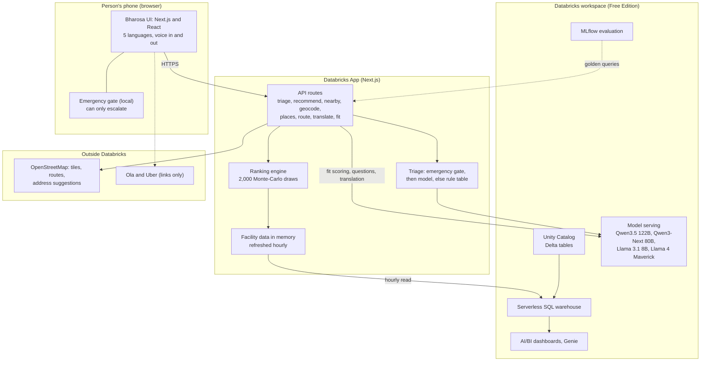

# Bharosa: find the right hospital, in your own language

Say or type what is wrong in English, Hindi, Tamil, Telugu or Malayalam. Bharosa decides how urgent it is and what care is needed, then recommends nearby hospitals. Each recommendation quotes the facility's own text with its source, says how sure we are, and explains why it was chosen.

Built for the CMU Datathon (Fall 2026) on a Databricks Free Edition workspace.

- **Live app:** https://facility-finder-7474656106086877.aws.databricksapps.com/ (a Databricks App, so it needs a Databricks sign-in)
- **Presentation video:** https://drive.google.com/file/d/1hcEAFn8CfhiTtsROzyHDNwi-Gi7GIGCM/view?usp=sharing

> Internal names still say "facility finder" (the Databricks app and the schema `workspace.facility_finder`).

## The challenge

Given a service (dialysis, C-section, NICU, MRI...) and a location, recommend the best facility. Cite the underlying text, communicate uncertainty, explain "why this facility" and "how did you decide", and run on Databricks Free Edition (no GPUs).

Our rules: no diagnosis or dosing; the emergency check can only escalate; no government emblem or PM-JAY logos and a clear "not affiliated" statement; no transcripts stored.

## Where we started and where we ended up

**Start:** three files. `facilities.csv` (9,989 real facilities scraped from web text, a structurally broken CSV), the India Post PIN directory (165,627 offices) and NFHS-5 district indicators. Every facility field is a *claim*, not a fact. Locations were unreliable (16% of facilities sit more than 50 km from their own PIN), and there are no prices, ratings, live beds or opening hours.

**Data work:** cleaning, a geocoder, location-trust labels, 15 services with graded claims and quoted evidence, trust and merge-suspicion scores, merged into `facilities_final.parquet`.

**End:** a phone-first app in five languages with voice in and out, a probabilistic ranker, an emergency gate, a PM-JAY cross-check, and the whole stack on Databricks.

| What changed | From | To | Why |
|---|---|---|---|
| Models | Llama 3.3 70B | Qwen3.5 122B (understanding), Qwen3-Next 80B (questions), Llama 3.1 8B (hospital fit), Llama 4 Maverick (fallback) | Better multilingual understanding; retry then fallback on rate limits |
| Data path | bundled JSON only | SQL warehouse reads a Delta table hourly, bundled copy as fallback | Data updates without a redeploy |
| Hosting | Vercel mirror planned | Databricks App only | One platform, no keys outside it |
| Ranking | additive score | plus a travel-time guard for urgent care | A 52-minute hospital outranked a solid one 20 minutes away |
| Location | town or PIN | any address, suggested as you type | People don't know their PIN |
| Ride links | Ola and Rapido | Ola and Uber | Rapido has no public deep link |
| Look and name | green highway-board, "facility finder" | calm navy/orange/teal palette, **Bharosa** | Clarity for frightened or unwell users |

## Architecture



Capability tiers (shown at `/api/health`): (1) warehouse data + model + routing, (2) bundled snapshot + model, (3) snapshot + rules + estimated travel times. Every tier works and the screen says which is in use.

## Databricks services and why

| Service | Use | Why |
|---|---|---|
| Unity Catalog, Delta tables | `fac_final`, `facility_claims`, `registry_match`, `hem_hospitals`, `app_snapshot` and more in `workspace.facility_finder` | One governed source of truth; claims are their own table so each answer can show its quote |
| SQL warehouse (serverless) | The app reads `app_snapshot` hourly; dashboards and Genie run on it | Live data with a safe fallback |
| Model serving (Foundation Model APIs) | Understands problems in five languages, writes questions, scores fit, translates short phrases | Meaning, not keywords |
| `ai_query` | Audited 150 claims per level against their quotes: supported Strong 72%, Moderate 55%, Weak 53% | Shows that one quote barely separates Strong from Weak |
| MLflow | `databricks/evaluate.py` runs golden queries against the deployed app | Repeatable quality numbers |
| AI/BI dashboards, Genie | 9-page EDA (maps, care deserts, trust, registry gap) and an "ask the data" space | Where the data is strong and where it is missing |
| Databricks Apps | Hosts the app next to the data and models | No separate server; managed identity, no keys in code |
| Jobs, notebooks | Table refresh job (paused), relationship-graph and map notebooks | Keep derived tables current; exploration |

## Tech stack

Next.js 16 (App Router), React 19, TypeScript, plain CSS tokens, Web Speech API, Vitest (341 tests), Python (pandas, pyarrow) for data pipelines, OpenStreetMap for maps and routing, Databricks CLI for deploys, Git LFS for large data.

## How a recommendation is made

1. **Understand:** emergency gate first (rules), then a model reads urgency, care needed and a short problem phrase; a rule table is the fallback.
2. **Find candidates:** widen from 25 to 200 km until six credible facilities exist; shortlist 15.
3. **Score as probabilities:** P(service offered) from named evidence signals, P(location right), and travel time with congestion noise. Cost and comfort are labelled proxies.
4. **Simulate:** 2,000 seeded draws over preference weights give P(best) and an interval. Under low P(best) the app says "several similar options".
5. **Time guard:** for urgent and emergency needs, a hospital far slower than the fastest solid one is penalised.
6. **Explain:** top signals become plain sentences with the quoted snippet and source ("Why this hospital").

## Safety

- **Emergency gate** (`web/lib/triage/redflags.ts`): deterministic rules in the browser and on the server, before and after any model. It can only escalate, shows 108 and 112, and ignores negated, past or fictional mentions.
- No diagnosis or dosing. Facility text is quoted data, never instructions.
- Typed address text goes to Photon (OpenStreetMap) through our server; use a hosted geocoder in production.
- Hindi, Tamil, Telugu and Malayalam text and all emergency wording are unreviewed drafts that need native-speaker and clinician review.

## PM-JAY cross-check

`hem_hospitals.csv` is a scraped copy of the National Health Authority's PM-JAY (Pradhan Mantri Jan Arogya Yojana, Ayushman Bharat) empanelment list: 39,737 hospitals, as of 2026-11-21. We matched it to our 9,989 facilities by name, place and phone:

- **1,452 verified** (same name and PIN, or phone + name + place), **531 possible**, **1,447 badge-eligible**.
- Verified matches get a PM-JAY badge; possible matches get a caution only; no match shows nothing and never implies illegitimacy.
- Listing adds a small capped trust signal and, if the person holds an Ayushman Bharat card, a cost signal. It does not prove a service is offered.

**Verification status:** a 100-pair review sheet (`scripts/out/registry_match_review.csv`) exists, with a rule that the badge ships only at 95% or better precision. **It has not been labelled, so precision is unmeasured.** Don't quote an accuracy figure.

## Testing

341 unit tests; MLflow golden queries (emergency recall 22/22, false alarms 0/11 at first run); a 389-case stress test of odd and hostile inputs (`databricks/stress_inputs.py`: 364 passed, 15 failed, 10 informational on the third run). Not done: real phones and microphones in all five languages, and a clinician-reviewed emergency red-team.

## Repository

| Path | What |
|---|---|
| `Dataset/`, `Person_1/`, `Person_2/` | Original data; facility cleaning; geography |
| `facilities_final.parquet`, `hem_hospitals.csv` | Final facilities and the PM-JAY list (Git LFS) |
| `scripts/` | Registry match, snapshot and geocoder exports |
| `web/` | The app: `app/` (pages, API), `components/`, `lib/` (ranking, triage, geocoder, i18n), `data/`, `tests/`, `app.yaml` |
| `databricks/` | SQL, dashboards, evaluation, stress test, notebooks, data loader |
| `HANDOFF.md` | Detailed engineering log, one section per change |
| `EDA_REPORT.md`, `PRODUCT.md`, `DESIGN.md` | Exploration report, product definition, design notes |

**Run locally**

```powershell
git lfs pull
cd web
npm install
npm test
npm run dev         # http://localhost:3000, runs in tier 3 with no configuration
```

Set `DATABRICKS_HOST`, credentials, `FM_ENDPOINT` and `DATABRICKS_WAREHOUSE_ID` (copy `web/.env.example` to `.env.local`) for the model and warehouse. Never commit secrets.

**Rebuild data and deploy** (from `web/`; in Git Bash set `MSYS_NO_PATHCONV=1`)

```powershell
python scripts/build_registry_match.py; python scripts/export_snapshot.py; python scripts/export_geocoder_data.py
python databricks/load_app_data.py
databricks sync . /Workspace/Hackathon/facility-finder-app
databricks apps deploy facility-finder --source-code-path /Workspace/Hackathon/facility-finder-app
```

## Known limits

- No prices, ratings, live beds or opening hours exist in the data; ranking weights are hand-set, so output is an evidence-weighted estimate, not calibrated.
- PM-JAY match precision is unmeasured; the scrape's terms of use are unconfirmed.
- Ola and Uber links follow their documented formats but were not tested on a phone; Ola's docs call for a partner token we don't have. Both run only in some cities.
- Phone microphone and spoken replies were fixed from known mobile behaviour, not confirmed on devices. Many phones have no Tamil, Telugu or Malayalam voice, so the app stays silent rather than read gibberish.
- Live traffic adapters were not tested against a real key; travel times are estimated unless routing answers.
