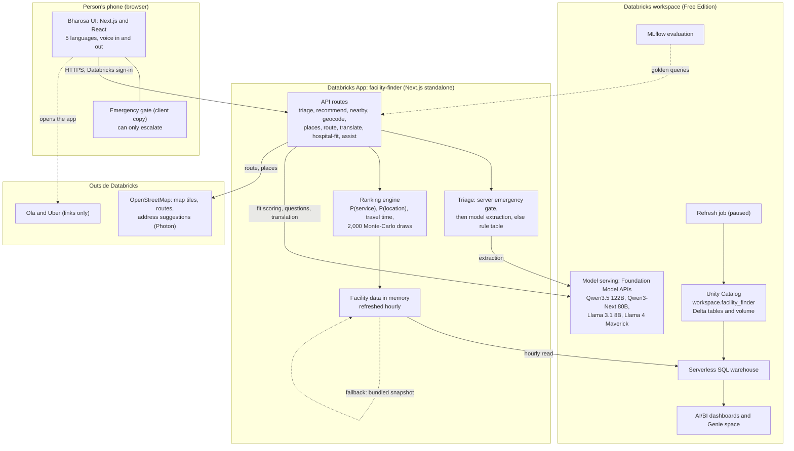
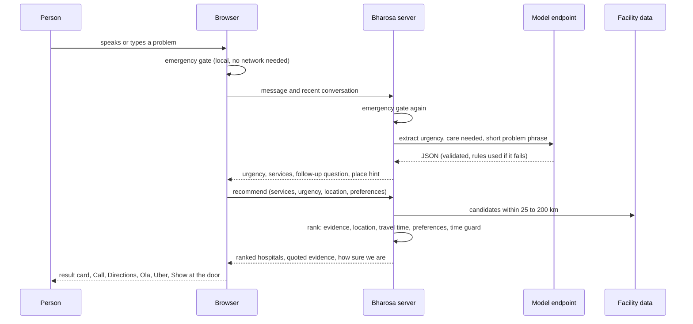

# Bharosa: find the right hospital, in your own language

Bharosa is a phone-first app for India. A person says or types what is wrong, in English, Hindi, Tamil, Telugu or Malayalam. The app decides how urgent it is and what kind of care is needed, then recommends nearby hospitals and clinics. Every recommendation quotes the facility's own text with its source, says how sure we are, and explains how it was chosen.

It was built for the CMU Datathon (Fall 2026) with Databricks, and the whole stack runs on a Databricks Free Edition workspace.

> Internal names still say "facility finder": the Databricks app, the schema `workspace.facility_finder` and some older docs. Bharosa is the product name.

**Contents**
1. [The problem and the rules we worked under](#1-the-problem-and-the-rules-we-worked-under)
2. [Where we started](#2-where-we-started)
3. [What we built, in the order we built it](#3-what-we-built-in-the-order-we-built-it)
4. [What we changed along the way](#4-what-we-changed-along-the-way)
5. [Where we ended up: architecture](#5-where-we-ended-up-architecture)
6. [Databricks services and why each is there](#6-databricks-services-and-why-each-is-there)
7. [Tech stack](#7-tech-stack)
8. [How a recommendation is made](#8-how-a-recommendation-is-made)
9. [Safety](#9-safety)
10. [The PM-JAY registry: what we did and what is verified](#10-the-pm-jay-registry-what-we-did-and-what-is-verified)
11. [How we tested it](#11-how-we-tested-it)
12. [Repository map, running and deploying](#12-repository-map-running-and-deploying)
13. [Known limits and what is not done](#13-known-limits-and-what-is-not-done)

---

## 1. The problem and the rules we worked under

The challenge brief (`CMU Datathon - Fall 2026 - Challenge.pdf`): given a **service** (dialysis, C-section, NICU, MRI and so on) and a **location**, recommend the best facility and explain why. Requirements:

- recommend facilities for a service and a place;
- cite the underlying text;
- communicate uncertainty honestly;
- answer "why this facility" and "how did you decide";
- run on Databricks Free Edition (no GPUs).

Rules the team added:

- The app never gives a diagnosis, treatment or dosing. It says "possible conditions to discuss with a clinician" and nothing stronger.
- The emergency check can only make things more urgent, never less.
- No State Emblem of India and no PM-JAY or Ayushman Bharat logos. The app states it is not affiliated with the Government of India or the National Health Authority (NHA).
- No transcripts are stored. A person's location is used for the request only.

## 2. Where we started

Three files and a question.

| File | Size | What it is |
|---|---|---|
| `facilities.csv` | 10,088 raw lines, **9,989 real facilities**, 51 columns | Facilities extracted from web text. Every field is a *claim*, not a fact |
| `india_post_pincode_directory.csv` | 165,627 post offices | PIN code to district, state and coordinates |
| `nfhs_5_district_health_indicators.csv` | 706 districts, 109 columns | District health survey (2019-21), for context only |

What the first look (`EDA.ipynb`, written up in `EDA_REPORT.md`) showed:

- the CSV was **structurally broken** (multi-line text fields), so row counts lied until it was parsed properly;
- many columns were dead, constant or redundant;
- locations were unreliable: 1,559 facilities (16%) have coordinates more than 50 km from their own PIN code, and about 12,000 of the 165,627 post offices have no coordinates at all;
- the evidence fields (specialties, procedures, equipment, capability) are free text scraped from websites, with no price, rating, live bed count or opening hours anywhere.

So the first decision was to treat the data as **evidence of varying quality**, not as a database of facts, and to make the app show that honestly.

The team split the data work into layers (the `Person_1` and `Person_2` folders are the first two; the others were merged into `facilities_final.parquet`):

- **Person 1: facility cleaning.** `build_fac_base.py` produces the clean base table. Report in `Person_1/PERSON1_REPORT.md`.
- **Person 2: location and geography.** PIN validation, a geocoder, coverage tables, an OpenStreetMap cross-check. Each facility gets a `location_trust` label and score.
- **Claims, trust and merge detection.** The 15 services we can recommend for (dialysis, C-section, obstetrics, NICU, ICU, cardiac surgery, cath lab, MRI, CT, burn care, trauma and emergency, blood bank, oncology, ventilator, linear accelerator), each claim with a level (Strong, Moderate, Inferred, Weak, Contradicted), its quoted snippets, the fields that agree, prerequisites, contradictions and the source URLs. Plus a `facility_trust` score from 0 to 100 and a `merge_suspect_score` for records that may mix several facilities.
- **Result:** `facilities_final.parquet`, 9,989 facilities and about 23,600 claims.

## 3. What we built, in the order we built it

1. **Cleaned, merged data** (above).
2. **A geocoder** (`web/lib/geocoder.ts`, ported from `Person_2/geocoder.py`): PIN, coordinates, place aliases, fuzzy matching, ambiguity handling, and any address that contains a 6-digit PIN.
3. **The PM-JAY registry match** (`scripts/build_registry_match.py`): a second, independent source to cross-check facilities (section 10).
4. **The ranking engine** (`web/lib/ranking.ts`): a probabilistic ranker with named evidence signals and a 2,000-draw Monte-Carlo simulation instead of one fixed score (section 8).
5. **Triage and the emergency gate** (`web/lib/triage/`): deterministic red-flag rules first, then a language model that reads the message, with a rule table as fallback.
6. **The app** (`web/`): Next.js API routes plus a phone-first interface in five languages, with voice in and out.
7. **The Databricks side:** Unity Catalog tables, a SQL warehouse, model serving, dashboards, a Genie space, MLflow evaluation, and the app itself hosted as a Databricks App.
8. **Language-model features:** hospital-fit scoring for needs that map to no service, follow-up questions in the person's language, a conversation that remembers context.
9. **Voice and accessibility:** speech input, read-aloud of every screen with word highlighting, replies spoken back when the person spoke, native-script place names.
10. **Stress testing:** 389 odd and hostile inputs, which led to emergency-gate, small-talk and rate-limit fixes.
11. **Ranking and location fixes** found by real use: urgent care now ranks by travel time, and the location picker suggests any address as you type.
12. **Finishing:** "Show at the door" card (what to say and what to bring, in your language), Ola and Uber ride buttons, the Bharosa name and logo, home-screen icons.

## 4. What we changed along the way

These are the real pivots, and why.

| Area | Started as | Ended as | Why |
|---|---|---|---|
| **Name and look** | "Facility finder"; an Indian highway-board look in green | **Bharosa**; a calm navy, orange, teal and sand palette, with a plus-and-bridge logo | The highway-board design read as heavy and confusing; a calm, phone-first style suits frightened or unwell users |
| **Main model** | Llama 3.3 70B | **Qwen3.5 122B A10B** for understanding, Qwen3-Next 80B for question writing, Llama 3.1 8B for hospital-fit scoring, Llama 4 Maverick as fallback | Better multilingual understanding. Qwen3.5 is a reasoning model and returned only reasoning (about 35% valid JSON) until we turned reasoning off |
| **Model load** | One endpoint | Retry once on HTTP 429, then fall back to a second endpoint | A stress run hit 92 rate-limit errors |
| **Data path** | Bundled JSON snapshot only (tier 2) | The app reads the Delta table through the **SQL warehouse** hourly (tier 1); the bundled snapshot is the fallback | So data updates without a redeploy |
| **Hosting** | A Vercel mirror was planned | **Databricks App only** | One platform; no keys leave Databricks. Vercel was dropped by decision |
| **UI library** | Glisse (liquid glass) | Plain CSS | Glass hurt readability of clinical content; Glisse was removed |
| **Ranking** | Additive score of speed, trust, comfort, cost | The same, **plus a travel-time guard** for urgent and emergency needs | A user found "pregnancy" ranked a hospital 52 minutes away above a solid one 20 minutes away. The extra trust and comfort points outweighed the delay |
| **Location** | Town or PIN only | Any address, street or landmark, with a dropdown while typing; the demo place is assumed until the person picks another | People do not know their PIN code |
| **Home tiles** | Only Emergency and Pregnancy treated as urgent | Heart and ICU too | The first fix only covered pregnancy and the same flaw showed on other tiles |
| **Show at the door** | A fixed sentence from the care type | A short phrase from the model, translated into the person's language | Spoken problems produced long awkward sentences, and non-English sheets were half English |
| **Ride buttons** | Ola and Rapido | **Ola and Uber**, with their own marks | Rapido has no public deep link; its button only opened the home page |
| **Voice on phones** | A second microphone stream drew the listening animation | Phones skip it; speech is unlocked on first touch | Phones give the microphone to one user at a time, so recognition heard nothing |
| **Emergency gate** | Basic keyword rules | Many more spellings and phrasings, plus a mask for negations, questions, past events and films | Stress runs found misses ("not breathing", "choking") and false alarms ("history of a heart attack") |
| **Small talk** | Every message got hospitals | Greetings and thanks get a reply and a question, no hospital cards | Showing hospitals for "hello" felt wrong |

## 5. Where we ended up: architecture



**Capability tiers (shown at `/api/health`):** (1) warehouse data + model + routing; (2) bundled snapshot + model; (3) bundled snapshot + rule-based triage + estimated travel times. Every tier works, and the screen labels what is being used, for example "cached data".

**One request, end to end:**



## 6. Databricks services and why each is there

| Service | What we use it for | Why |
|---|---|---|
| **Free Edition workspace** | Everything below | The challenge requires it; there are no GPUs |
| **Unity Catalog and Delta tables** (`workspace.facility_finder`) | `fac_final`, `facility_claims`, `facilities_serving`, `registry_match`, `hem_hospitals`, `app_snapshot`, graph and EDA tables; volume `raw` | One governed source of truth. Claims are their own table so every recommendation can show its quote and source |
| **SQL warehouse** (serverless starter, 2X-Small) | The app reads `app_snapshot` hourly; dashboards and Genie run on it; our SQL scripts use it | Data updates without redeploying; the app falls back to a bundled copy if the warehouse is slow |
| **SQL function** `find_facilities(service, lat, lon, max_km)` | Nearby facilities with solid evidence, queryable from SQL and Genie | Lets non-engineers ask the same question the app asks |
| **Model serving** (Foundation Model APIs, pay-per-token, hosted by Databricks) | Understanding a problem in five languages; writing questions; scoring hospital fit; translating short phrases; fallback | Meaning, not keywords: "my father gets breathless on stairs" must work in Tamil too |
| **`ai_query`** | A claim audit: a model judged 150 claims per level against their quoted text. Share judged supported by the quote: Strong 72%, Moderate 55%, Weak 53% | Shows honestly that one quote barely separates Strong from Weak, so levels rest on more than one snippet |
| **MLflow** (`/Workspace/Hackathon/facility-finder-eval`) | `databricks/evaluate.py` runs golden recommendation queries and triage prompts against the deployed app and logs the results | Repeatable quality numbers instead of impressions |
| **AI/BI dashboards** | "Facility finder: EDA, maps and care deserts (v2)" (9 pages, maps of India, care deserts, need versus supply, evidence and trust, registry gap) and a demo dashboard | Shows where the data is strong and where it is missing |
| **Genie space** | "Facility finder: ask the data" over the main tables | Ask the data in plain language |
| **Databricks Apps** | Hosts the Next.js app next to the data and models | No separate server; the app uses its own managed identity, so no keys are in the code |
| **Jobs** | `facility-finder-refresh` rebuilds serving, claims and graph tables from `fac_final` (paused) | Keeps derived tables in step with the source |
| **Notebooks** | `facility_graph` (relationship graph of facilities, places and services), `facility_eda_maps` | Exploration and the evidence story |

## 7. Tech stack

| Layer | Choice |
|---|---|
| Frontend | Next.js 16 (App Router, standalone output), React 19, TypeScript, plain CSS tokens, lucide-react icons |
| Voice | Browser Web Speech (recognition and synthesis); read-along highlighting; per-language voice picker |
| Backend | Next.js route handlers on Node, per-IP rate limiting |
| Ranking | TypeScript, seeded Monte-Carlo, unit-tested |
| Data | Python (pandas, pyarrow) pipelines to Parquet, Delta in Unity Catalog, JSON snapshot for fallback |
| Maps and routing | OpenStreetMap tiles and routing, Photon for address suggestions (called by our server, never the browser); optional Google Routes or Mapbox keys |
| Tests | Vitest: 341 tests (ranker, geocoder, emergency gate, triage, places, rides, five-language checks, golden queries) |
| Tooling | Databricks CLI (`sync` and `apps deploy`), Git LFS for large data files |

## 8. How a recommendation is made

All of this lives in `web/lib/` and is deterministic given a seed.

1. **Understand.** Emergency gate (rules) first, then the model extracts urgency, the services needed and a short phrase for the problem. If the model is down, a reviewed rule table takes over.
2. **Find candidates.** Start at 25 km and widen to 50, 100 and 200 km until six credible facilities exist. Shortlist 15. If nothing exists nearby, the app says how far the nearest one is instead of showing an empty list.
3. **Score each one**, as probabilities rather than a single number:
   - **P(the facility offers the service):** log-odds built from named signals: claim level, number of agreeing fields, specificity, prerequisites met, contradictions (large penalty), citations that name the facility, facility trust, merge suspicion (penalty), PM-JAY listing (capped) and NABH accreditation.
   - **P(the location is right):** from the location-trust label.
   - **Travel time:** from routing, with noise that grows with congestion.
4. **Combine with what the person cares about.** Preference weights for speed, trust, cost, comfort and government facilities are sampled from a Dirichlet distribution. Cost and comfort are **proxies** (public or private, size, equipment depth, PM-JAY listing) and are labelled so.
5. **Simulate.** 2,000 seeded draws give P(best), expected rank and an interval for each option. Under a low P(best) the app says "several similar options" instead of faking certainty.
6. **Time guard for urgent care.** For urgent and emergency needs, a hospital far slower than the fastest hospital with solid evidence is penalised (grace 10 minutes for urgent, 5 for emergency). Routine care gets a gentler version. Among hospitals that can do the job, time decides.
7. **Explain.** The top positive and negative signals become plain sentences with the quoted snippet, its source and how sure we are, behind "Why this hospital".

## 9. Safety

- **Emergency gate** (`web/lib/triage/redflags.ts`, plus Indian-language stems): deterministic rules for chest pain, not breathing, stroke signs, seizures, heavy bleeding, pregnancy emergencies, poisoning, snakebite, self-harm and more. It runs in the browser (works offline) and on the server, before and after any model, and **can only escalate**. It shows 108 and 112 and "while you wait" lines. It ignores negated, informational, past and fictional mentions ("no chest pain", "history of a heart attack", a film scene).
- **No diagnosis or dosing.** Requests for medicine or doses get a plain "this app does not give these" and the app carries on finding care.
- **Facility text is quoted data, never instructions** (prompt-injection defence).
- **Privacy.** No transcripts stored. Location used per request. The microphone notice says browser speech may reach the browser vendor. Typed address text is sent to Photon (OpenStreetMap) by our server for suggestions, so a production deployment should switch to a hosted geocoder with an agreement.
- **Language review is still needed.** Hindi, Tamil, Telugu and Malayalam text, and all emergency wording, are machine-written drafts that need native-speaker and clinician review.

## 10. The PM-JAY registry: what we did and what is verified

**The data.** `hem_hospitals.csv` is a scraped copy of the NHA's PM-JAY (Ayushman Bharat) empanelment list: 39,737 hospitals as of 2026-11-21. Source and terms of use are still to be confirmed. It is not ground truth (12.7% of its coordinates are over 25 km from its own PIN).

**What we did.** We matched it to our facilities by name, place and phone:

| Tier | Count | Rule |
|---|---|---|
| Verified | 1,452 | same name and same PIN (or within 1.5 km), or phone plus name plus place |
| Possible | 531 | weaker signals only |
| Badge-eligible | 1,447 | verified, and not suspended or de-empanelled |

129 helpline numbers were ignored so they could not cause false phone matches.

**How it shows.** Verified matches get a green "PM-JAY" badge that opens a card saying what was cross-checked. Possible matches get a caution line and never a badge. No match shows nothing, and never implies a hospital is illegitimate. Listing adds a small capped trust signal and, if the person has an Ayushman Bharat card, a cost signal. It does not prove a service is offered.

**Verification status, stated exactly.** We wrote a 100-pair review sheet (`scripts/out/registry_match_review.csv`, 45 verified pairs and 55 possible) and set a rule that the badge ships only if verified precision is at least 95%. **Nobody has labelled that sheet yet, so the precision has not been measured.** Do not describe the matches as verified or give an accuracy figure.

## 11. How we tested it

- **Unit and golden tests:** 341 Vitest tests, all passing.
- **Evaluation in MLflow:** at the time of the first full run, emergency recall 22 of 22, false alarms 0 of 11, service mapping 100%, 11 of 12 golden recommendation queries passing (the failure was a Lucknow C-section query where the best option had only inferred evidence).
- **Stress test of odd and hostile inputs** (`databricks/stress_inputs.py`): 389 cases in 34 categories (typos, mixed scripts, emergencies in disguise, jokes, prompt injection, requests for doses, empty and very long input). First run 201 passed and 18 failed; after fixes the third run had 364 passed, 15 failed and 10 informational. What remains: about 2% dropped connections, a few expectations that were too strict, and one "how to hurt someone" phrasing that still raises the emergency card.
- **Real use found the rest:** the 52-minute pregnancy result, the half-translated door sheet, the broken phone microphone and the missing home-screen icon all came from someone using the app.
- **Not done:** testing on real phones and microphones in all five languages, and a red-team of the emergency gate with 100 or more prompts reviewed by a clinician.

## 12. Repository map, running and deploying

| Path | What it is |
|---|---|
| `Dataset/` | The original three files (do not edit) |
| `Person_1/`, `Person_2/` | Facility cleaning; location and geography |
| `facilities_final.parquet` | Final merged facility table (Git LFS) |
| `hem_hospitals.csv` | The PM-JAY list (Git LFS) |
| `scripts/` | Registry match, snapshot export, geocoder data export |
| `web/` | The Next.js app: `app/` (pages and API routes), `components/`, `lib/` (ranking, triage, geocoder, i18n), `data/` (snapshot), `tests/`, `app.yaml` |
| `databricks/` | SQL, dashboards builder, evaluation, stress test, notebooks, data loader |
| `EDA.ipynb`, `EDA_REPORT.md`, `figures/` | The first exploration |
| `HANDOFF.md` | The detailed engineering log, one section per change |
| `PRODUCT.md`, `DESIGN.md` | Product definition and design notes (`DESIGN.md` still describes an earlier look) |

**Run locally**

```powershell
git lfs pull
cd web
npm install
npm test            # 341 tests
npm run dev         # http://localhost:3000
```

With no configuration the app runs in tier 3 (snapshot and rules). Set `DATABRICKS_HOST`, credentials, `FM_ENDPOINT` and `DATABRICKS_WAREHOUSE_ID` to enable the model and warehouse; copy `web/.env.example` to `.env.local` and never commit secrets.

**Rebuild the data**

```powershell
python scripts/build_registry_match.py
python scripts/export_snapshot.py
python scripts/export_geocoder_data.py
python databricks/load_app_data.py     # push the snapshot to the Delta table
```

**Deploy to Databricks** (from `web/`; in Git Bash set `MSYS_NO_PATHCONV=1`)

```powershell
databricks sync . /Workspace/Hackathon/facility-finder-app
databricks apps deploy facility-finder --source-code-path /Workspace/Hackathon/facility-finder-app
```

A Databricks App always needs a Databricks sign-in. It cannot be made public, so people are added to it by permission.

## 13. Known limits and what is not done

- **No prices, ratings, live beds or opening hours** exist in the data. Cost and comfort are labelled proxies. Ranking weights are hand-set until real manual verifications exist, so output is an "evidence-weighted estimate", not calibrated.
- **PM-JAY match precision is unmeasured** (section 10).
- **Translations and emergency wording are unreviewed drafts.**
- **Ola and Uber:** the Uber link follows its documented format and the Ola link follows its developer docs, but Ola's docs call for a partner token we do not have, so pre-filling the drop is unconfirmed. Neither was tested on a real phone. Both apps run only in some cities.
- **Phones:** the microphone and spoken replies were fixed from known mobile browser behaviour but not confirmed on real devices. Many phones have no Tamil, Telugu or Malayalam voice installed; the app stays silent rather than read gibberish.
- **Address suggestions** use Photon, a public fair-use service, with a hosted geocoder needed for real users.
- **Traffic:** live traffic adapters exist but were not tested against a real key; travel times are estimated unless routing answers.
- **Two things are labelled clearly in the app instead of hidden:** cached data (warehouse unavailable) and estimated travel time.
- **Open decisions:** whether the PM-JAY list may be used beyond validation, whether to show the roughly 38,000 listed hospitals missing from our data as a separate labelled pool, and the source terms of the registry scrape.
